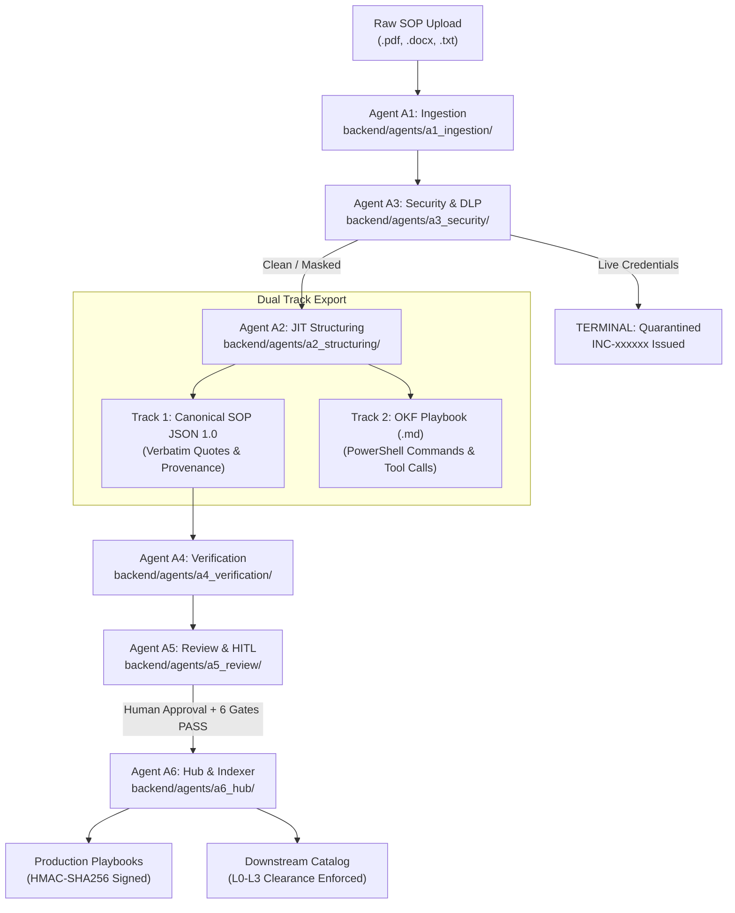

# Elone Agent — Enterprise SOP Governance, Structuring & Execution Hub

[](https://www.python.org/)
[](backend/schemas/)
[](backend/schemas/protocol_msg.py)
[](backend/orchestrator/ledger.py)
[-brightgreen.svg)](backend/tests/)

Elone Agent is an enterprise multi-agent governance and execution system that autonomously transforms unstructured human Standard Operating Procedures (PDFs, Word documents with embedded screenshots, text, and tables) into validated, deterministic **OKF (Operational Knowledge Framework) Playbooks** and **Canonical SOP JSON 1.0 records**.

The system features a **Dual-Track Architecture**:
- **Track 1 (Governance & Audit):** Generates Canonical SOP JSON 1.0 with verbatim source line quote-tracing ($\pm 1$ line verification), mathematical quality scoring, and multi-tenant clearance cataloging ($L0$–$L3$).
- **Track 2 (Deterministic Execution):** Emits HMAC-SHA256 digitally stamped OKF playbooks containing executable PowerShell commands, API tool calls, and variable dependency chains for L1/L2 autonomous execution runtimes.

---

## Table of Contents

- [Core Architecture](#core-architecture)
  - [The 6-Agent Modular Architecture](#the-6-agent-modular-architecture)
  - [14-State Orchestrator Lifecycle](#14-state-orchestrator-lifecycle)
  - [Inter-Agent Communication Protocol (msg/1.0)](#inter-agent-communication-protocol-msg10)
- [Multi-LLM Routing & Resiliency](#multi-llm-routing--resiliency)
- [Dynamic Configuration System](#dynamic-configuration-system)
- [Governance, Security & Scoring Rubrics](#governance-security--scoring-rubrics)
  - [Mathematical Quality Scoring](#mathematical-quality-scoring)
  - [Confidentiality Scoring & Clearance Tiers](#confidentiality-scoring--clearance-tiers)
  - [Dual-Custody Separation of Duties (SoD)](#dual-custody-separation-of-duties-sod)
  - [The 6 Publication Gates](#the-6-publication-gates)
- [Downstream Multi-Tenant Catalog](#downstream-multi-tenant-catalog)
- [Quickstart & Usage](#quickstart--usage)
  - [1. Interactive Pipeline Tracer](#1-interactive-pipeline-tracer)
  - [2. FastAPI Backend Server](#2-fastapi-backend-server)
  - [3. Running Test Suites](#3-running-test-suites)
- [Repository Structure](#repository-structure)
- [License](#license)

---

## Core Architecture

### The 6-Agent Modular Architecture

The backend is decomposed into six decoupled agent modules under [`backend/agents/`](backend/agents/):



| Agent | Module | Primary Responsibilities |
| :--- | :--- | :--- |
| **A1** | [`a1_ingestion`](backend/agents/a1_ingestion/) | File intake validation (magic bytes, size caps, zip-bomb defense), PyMuPDF/MarkItDown parsing, VLM visual extraction. |
| **A2** | [`a2_structuring`](backend/agents/a2_structuring/) | Dynamic tool-aware triage routing, specialized prompt dispatch, OKF execution planning, canonical JSON synthesis. |
| **A3** | [`a3_security`](backend/agents/a3_security/) | Shannon entropy scan, DLP credential masking (`[REDACTED_SECRET]`), AST command safety sandboxing (<1ms). |
| **A4** | [`a4_verification`](backend/agents/a4_verification/) | Lineage validation, $\pm 1$ line verbatim quote tracing, LLM faithfulness inspection, quality score calculation. |
| **A5** | [`a5_review`](backend/agents/a5_review/) | Dual-custody draft staging (`_drafts/`), review task emission (`RT-xxxxxx`), 24h/48h SLA routing, SoD enforcement. |
| **A6** | [`a6_hub`](backend/agents/a6_hub/) | 6 publication gate evaluation, HMAC-SHA256 digital stamping, multi-tenant clearance-filtered catalog indexing. |

---

### 14-State Orchestrator Lifecycle

Managed by [`backend/orchestrator/ledger.py`](backend/orchestrator/ledger.py), the ingestion lifecycle enforces strict, deterministic transitions:

```
received ──> extracting ──> scanning ──> structuring ──> assessing ──> awaiting_review ──> approved ──> published
   │             │             │             │               │                │
   ├──> duplicate├──> rejected └──> quarantined (INC-xxxxxx) └──> correcting └──> changes_requested
   └──> failed
```

* **Terminal States (`quarantined`, `duplicate`, `rejected`, `failed`):** Immediate execution halt.
* **Secret Quarantine Protocol:** If credentials or sensitive keys are found during `scanning`, processing aborts instantly, raw text is wiped, and ticket `INC-xxxxxx` is emitted with **0 subsequent LLM calls**.

---

### Inter-Agent Communication Protocol (`msg/1.0`)

Implemented in [`backend/schemas/protocol_msg.py`](backend/schemas/protocol_msg.py) and routed via [`backend/orchestrator/bus.py`](backend/orchestrator/bus.py):

* **Standard Envelopes:**
  * `TaskMessage`: Fields include `task_id` (`tsk-xxxxxx`), `correlation_id`, `tenant_id`, `sop_id`, `source_content_hash`, `sender`, `recipient`, `task_type`, `schema_version: "msg/1.0"`, `input_artifact_references`, `idempotency_key`, and `timeout_ms`.
  * `ResultMessage`: Fields include `task_id`, `correlation_id`, `agent_id`, `status` (`success`, `partial_success`, `needs_review`, `blocked`, `failed`, `retryable_failure`), `output_artifact_reference`, `structured_findings`, and `unresolved_issues`.
* **Pass-by-Reference (`ArtifactStore`):** Payloads (raw source, extracted text, models) are stored with SHA-256 digests; agents pass `art-xxxxxx` IDs rather than raw content in prompts.
* **Rigid 12-Route Matrix:** Restricts agent communication strictly to authorized handoffs (e.g. `orchestrator` $\rightarrow$ `A1`, `A1` $\rightarrow$ `A2`, `A2` $\rightarrow$ `A4`, `A5` $\rightarrow$ `A6`). Arbitrary jumps raise `RouteNotAllowedError`.
* **Idempotency Cache:** Caches results under `job:task:version:revision:loop` keys to prevent double-execution.

---

## Multi-LLM Routing & Resiliency

Configured in [`backend/config/llm_config.py`](backend/config/llm_config.py):

| Pipeline Role | Provider | Model | Latency | Fallback Strategy |
| :--- | :--- | :--- | :--- | :--- |
| **Execution Planning** | **Groq** | `qwen/qwen3.8-27b` | `~0.20s` | Auto-cascades to Z.ai `glm-4.7-flash` $\rightarrow$ `glm-4.5-flash` |
| **Plan Validation** | **Z.ai** | `glm-4.7-flash` | `~0.35s` | LangChain `.with_fallbacks([glm-4.5-flash])` on HTTP 429 server overload |
| **VLM Image Analysis** | **NVIDIA NIM** | `meta/llama-3.2-11b-vision-instruct` | Variable | Configured with `150s` read timeout and base64 downscaling |

---

## Dynamic Configuration System

All operational parameters are dynamically hot-reloadable from [`backend/config/settings.json`](backend/config/settings.json) without code changes or server restarts:

```json
{
  "file_upload": {
    "max_file_size_mb": 50.0,
    "max_page_count": 10,
    "max_text_lines": 600,
    "max_text_words": 5000,
    "allowed_extensions": [".pdf", ".docx", ".csv", ".xls", ".xlsx", ".md", ".txt"]
  },
  "images": {
    "max_images_per_sop": 15,
    "max_image_dimension": 4096,
    "target_image_dimension": 1024,
    "allowed_extensions": [".png", ".jpg", ".jpeg", ".webp", ".gif"]
  },
  "llm_models": {
    "execution_planning": { "provider": "groq", "model": "qwen/qwen3.8-27b", "temperature": 0.0 },
    "planning_validation": { "provider": "zai", "model": "glm-4.7-flash", "temperature": 0.0 },
    "vlm_image_analysis": { "provider": "nvidia", "model": "meta/llama-3.2-11b-vision-instruct", "temperature": 0.2, "timeout": 150 }
  },
  "governance": {
    "min_passing_score": 80.0,
    "max_daily_calls": 0,
    "unlimited_daily_calls": true,
    "sop_scan_interval_minutes": 10
  }
}
```

Precedence: **Environment Variables (`.env`)** $>$ **`settings.json`** $>$ **Internal Defaults**.

---

## Governance, Security & Scoring Rubrics

### Mathematical Quality Scoring

Defined in Section 12 of the frozen specification and calculated by Agent A4:

$$Q = 0.4 \times C + 0.4 \times T + 20\,(\text{if schema valid}) - 5 \times B$$

Where:
- **Completeness ($C \in [0.0, 100.0]$):** $\left(\frac{\text{Mapped Source Lines}}{\text{Total Non-Blank Source Lines}}\right) \times 100$
- **Traceability ($T \in [0.0, 100.0]$):** $\left(\frac{\text{Verified Verbatim Quotes}}{\text{Total Extracted Quotes}}\right) \times 100$ (evaluated within a $\pm 1$ line source window)
- **Blocking Issues ($B$):** Count of open security violations, prompt injections, or missing step errors.

Thresholds: **Ready** ($\ge 85.0$), **Needs Attention** ($70.0$–$84.9$), **Failed Checks** ($< 70.0$).

---

### Confidentiality Scoring & Clearance Tiers

Calculated by Agent A3:

$$\text{Confidentiality Score} = \text{Baseline (5)} + \sum \text{Evidence Points}$$

- **Tiers:** **L0 Public** ($< 21$), **L1 Internal** ($21$–$50$), **L2 Confidential** ($51$–$75$), **L3 Restricted** ($\ge 76$).
- **Sensitivity Floor Constraint:** AI semantic assessment can only raise the clearance tier, never lower deterministic code calculations:
  $$\text{Final Level} = \max(\text{rule\_level}, \text{ai\_suggested\_level})$$

---

### Dual-Custody Separation of Duties (SoD)

Enforced before approval:
1. **Author $\ne$ Reviewer:** The user or automated service that ingested the SOP cannot approve it.
2. **Human Actor Mandate:** Rejects programmatic or LLM auto-approval (`reviewer_is_human: True` required).
3. **SLA Deadlines:**
   - Score $\ge 60$ or Tier $L2/L3 \rightarrow$ **Security Reviewer** (24h SLA).
   - Standard $L0/L1 \rightarrow$ **Process Owner** (48h SLA).

---

### The 6 Publication Gates

All 6 gates must pass before an approved draft can be published:
1. **Secret Gate:** 0 live credentials, not in quarantine.
2. **Canonical Schema Gate:** Valid against Canonical SOP JSON Schema 1.0 (0 validation errors).
3. **Traceability Gate:** Verbatim quote traceability $\ge 90\%$.
4. **Completeness Gate:** Extraction completeness $\ge 80\%$.
5. **Conflict Gate:** 0 open blocking issues and zero rule-vs-AI conflicts.
6. **Classification Gate:** Human confirmation of confidentiality tier.

---

## Downstream Multi-Tenant Catalog

Managed by [`backend/agents/a6_hub/retrieval_catalog.py`](backend/agents/a6_hub/retrieval_catalog.py):
- **Clearance Filtering:** Downstream executing agents can only retrieve SOPs at or below their assigned clearance rank ($\text{Clearance}_{\text{SOP}} \le \text{Clearance}_{\text{Agent}}$).
- **Tenant Isolation:** Enforces strict multi-tenant partition (`SOP.tenant_id == Agent.tenant_id`).
- **Standard Immutable Citations:** Emits citations in the format `{sop_id}@v{version}#{content_sha256[:10]}`.
- **Instant Purge:** Changing state to `deactivated` or `archived` instantly evicts the playbook from the index.

---

## Quickstart & Usage

### 1. Interactive Pipeline Tracer

Run the full end-to-end trace with stage-by-stage console observability and an interactive Human-in-the-Loop review gate:

```powershell
# Launch interactive explorer (choose from sample PDF/DOCX or enter custom path)
.\venv\Scripts\python.exe backend/trace_pipeline.py

# Trace a specific custom SOP file directly
.\venv\Scripts\python.exe backend/trace_pipeline.py --file "path/to/sop.pdf"

# Auto-approve mode (non-interactive, for automation or CI/CD)
.\venv\Scripts\python.exe backend/trace_pipeline.py --sample windows_kill --auto-approve
```

### 2. FastAPI Backend Server

Run the production API server:

```powershell
.\venv\Scripts\python.exe backend/server.py
```
* Interactive OpenAPI Swagger Docs: `http://127.0.0.1:8000/docs`
* Telemetry Status: `http://127.0.0.1:8000/api/telemetry/status`

### 3. Running Test Suites

Run the complete 91-test regression and modular test suite:

```powershell
.\venv\Scripts\python.exe -m unittest discover -s backend/tests -p "test_*.py"
```
```text
Ran 91 tests in 209.237s
OK
```

Run provider connectivity and rate-limit diagnostics:

```powershell
.\venv\Scripts\python.exe backend/test_llm_providers.py
```

---

## Repository Structure

```
Elone_Agent/
├── backend/
│   ├── agents/
│   │   ├── a1_ingestion/          # Intake validation, PyMuPDF, VLM extraction
│   │   ├── a2_structuring/        # Triage router, execution planner, OKF & Canonical builders
│   │   ├── a3_security/           # DLP secret scanner, confidentiality engine, AST sandbox
│   │   ├── a4_verification/       # Plan validator, quote tracer, quality scoring engine
│   │   ├── a5_review/             # SoD policy, review tasks (RT-xxxxxx), draft staging
│   │   └── a6_hub/                # 6 publication gates, HMAC signing, retrieval catalog
│   ├── orchestrator/
│   │   ├── ledger.py              # 14-state lifecycle state machine & persistent audit ledger
│   │   └── bus.py                 # msg/1.0 agent message bus & artifact store
│   ├── config/
│   │   ├── settings.py            # Dynamic settings manager
│   │   ├── settings.json          # Primary hot-reloadable configuration
│   │   ├── pipeline_config.json   # Synced configuration mirror
│   │   └── llm_config.py          # Groq, Z.ai GLM, NVIDIA NIM LLM bindings & fallbacks
│   ├── api/                       # FastAPI route controllers
│   ├── schemas/                   # Pydantic models (OKF, Canonical SOP, msg/1.0, Governance)
│   ├── tests/                     # 91 unit and integration tests
│   ├── trace_pipeline.py          # Interactive end-to-end CLI tracer
│   └── server.py                  # Main application server
├── docs/
│   ├── SOP_Governance_Hub_v1.0_Requirement.pdf # Frozen v1.0 governance specification
│   └── images_ui/                 # UI reference designs
├── frontend/                      # User interface (preserved)
├── knowledge_base/
│   ├── _uploads/                  # Raw input SOPs (.pdf, .docx, .txt)
│   ├── sops/                      # Production HMAC-signed playbooks
│   └── patterns/                  # Reflection rulebooks & learned execution constraints
├── .env.example                   # Environment configuration template
├── .gitignore                     # Git ignore rules
└── README.md                      # Project documentation
```

---

## License

Proprietary. Copyright © 2026 Elone Agent Team. All rights reserved.
