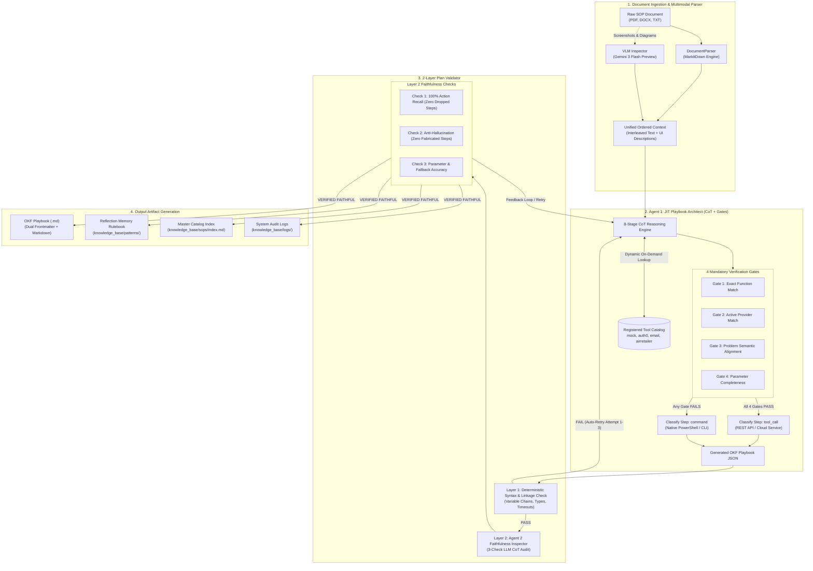

# SOP Ingestion Pipeline — Standalone Engine

[](https://www.python.org/)
[](core/okf_schema.py)
[](core/jit_converter.py)

A self-contained, enterprise-grade ingestion and translation engine that converts unstructured human Standard Operating Procedures (PDFs, Word documents with screenshots, plain text, and scan images) into deterministic, machine-executable **OKF (Operational Knowledge Framework) Playbooks** for autonomous IT support agents.

---

## Architecture Flowchart



---

## Core Capabilities

- **Unified Text & Multimodal Visual Parsing**:
  - Automatically extracts procedural text and embedded screenshots from Word (`.docx`) and `.pdf` files.
  - Employs Vision-Language Models (VLM) to describe UI buttons, dialogues, and windows, interleaving them in exact chronological sequence with the textual instructions.
- **Dynamic On-Demand Tool Catalog**:
  - Automatically queries registered IT platforms (`mock` L1 Platform, `auth0` Identity, `email` Notifications, `airretailer` VPN/RDP) on demand, eliminating prompt bloat and saving ~40% token overhead.
- **4 Mandatory Verification Gates**:
  - Evaluates each action against function matching, provider status, problem alignment, and parameter completeness before deciding between an API `tool_call` or a native CLI `command`.
- **2-Layer Validation & Auto-Retry Loop**:
  - **Layer 1**: Deterministic Python regex and Pydantic validator ensuring zero broken variable links and valid execution timeouts.
  - **Layer 2**: Independent LLM inspector performing a 3-check audit (Recall Preservation, Anti-Hallucination, Fallback Accuracy) with automated retry correction.
- **Dual-Representation Playbooks**:
  - Produces structured YAML frontmatter for machine execution (Elone Agent runtime) and formatted GitHub-flavored Markdown for human L1/L2 engineering audits.

---

## Project Structure

```
sop_ingestion_standalone/
├── run.py                      # Production CLI runner (--file, --scan, --watch, --status)
├── debug_run.py                # Debug CLI runner with untruncated internal reasoning logs
├── scheduler.py                # Background folder watcher daemon
├── test_standalone.py          # Unit test test suite (Layer 1, Schema, Parser)
├── requirements.txt            # Python dependencies
├── .env.example                # API key configuration template
│
├── config/                     # Configuration and dynamic tools
│   ├── llm_config.py           # Multi-provider LLM factory (Gemini + Mistral fallback)
│   └── tool_catalog.py         # Registered tool discovery and schemas
│
├── core/                       # Ingestion & Translation Engine
│   ├── document_parser.py      # MarkItDown + PyMuPDF + python-docx extractor
│   ├── vlm_inspector.py        # Gemini VLM visual screenshot analyzer
│   ├── jit_converter.py        # 8-Stage CoT Playbook Architect (Agent 1)
│   ├── plan_validator.py       # 2-Layer Linkage & Faithfulness Validator (Agent 2)
│   └── okf_schema.py           # Pydantic v2 OKF schema definitions
│
├── prompts/                    # Prompts & Reasoning Mandates
│   ├── jit_converter_prompts.py # 8-Stage CoT & 4-Gate Converter Prompt
│   ├── plan_validator_prompts.py# 3-Check Faithfulness Inspector Prompt
│   └── vlm_prompts.py          # Multimodal UI Screenshot Extraction Prompt
│
├── tools/                      # Tool definitions & mock platforms
│   └── tool_schemas.py         # Active API schemas (Mock, Auth0, Email, AirRetailer)
│
└── knowledge_base/             # Knowledge repository
    ├── _uploads/               # INPUT: Drop raw SOP files (PDF, DOCX, TXT) here
    ├── sops/                   # OUTPUT: Generated OKF Playbooks categorized by domain
    │   ├── logins/             # Identity & access playbooks
    │   ├── software/           # Application unblock & lifecycle playbooks
    │   ├── network/            # VPN & connectivity playbooks
    │   └── index.md            # Master Playbook Catalog
    ├── patterns/               # OUTPUT: Reflection rulebooks & learned constraints
    └── logs/                   # OUTPUT: Audit trails, parser dumps, and debug logs
        └── debug/              # Untruncated dual-logger execution traces
```

---

## Quick Start

### 1. Environment Setup

```powershell
# Create and activate Python virtual environment
python -m venv .venv
.\.venv\Scripts\activate    # Windows
# source .venv/bin/activate  # Linux/macOS

# Install dependencies
pip install -r requirements.txt
```

### 2. Configure API Keys

Copy `.env.example` to `.env` and set your API keys:

```ini
# Primary Provider
GOOGLE_API_KEY="your-google-gemini-api-key"

# Fallback Provider (Automatic failover during rate limits)
MISTRAL_API_KEY="your-mistral-api-key"
```

> [!TIP]
> The engine features **automatic multi-provider failover**. If your primary model hits rate limits or quota boundaries, the pipeline seamlessly shifts to the fallback model without interrupting conversion.

### 3. Validate Installation

Run the deterministic test suite:

```powershell
python test_standalone.py
```

---

## Usage Guide

### A. Convert a Single SOP File

Process any document in `knowledge_base/_uploads/`:

```powershell
python run.py --file knowledge_base/_uploads/sample_account_unlock.txt
```

### B. Run Full Internal Reasoning Debug Traces

To inspect the complete internal reasoning of both Agent 1 (JIT Converter) and Agent 2 (Plan Validator) saved directly to disk:

```powershell
# Pass just the file name; it auto-searches knowledge_base/_uploads/
python debug_run.py -f sop_software_application_unblock_request_ifeo.pdf
```

### C. Batch Scan All Unprocessed SOPs

Scan the entire `_uploads/` directory and convert all pending documents:

```powershell
python run.py --scan
```

### D. Start the Automated Folder Watcher Daemon

Watch `knowledge_base/_uploads/` continuously in the background:

```powershell
python run.py --watch --interval 5
```

---

## Generated Playbook Anatomy

Every generated OKF Playbook (`knowledge_base/sops/<category>/SOP-*.md`) is structured as a dual-layer document:

```markdown
---
type: Playbook
sop_id: SOP-L1-APP-001
title: Software Application Unblock Request (IFEO Debugger Entry Removal)
category: software
target_os: windows
description: Automates identification and removal of IFEO debugger entries blocking applications.
required_entities:
  - hostname
  - executable
trigger_words:
  - unblock
  - application
  - IFEO
steps:
  - step_number: 1
    sop_step_description: Verify endpoint connectivity using Test-Connection.
    step_type: command
    command: Test-Connection {{entities.computer_name}} -Count 2
    shell: powershell
    expected_output_contains: "Reply from"
    output_variable: connectivity_result
    output_parse_instruction: "If output contains 'Reply from', set 'connectivity_confirmed' to 'true'."
    execute_if: null
    timeout_seconds: 30

  - step_number: 2
    sop_step_description: Identify if the application is blocked by an IFEO Debugger entry.
    step_type: command
    command: reg query "HKLM\SOFTWARE\Microsoft\Windows NT\CurrentVersion\Image File Execution Options\{{entities.application_exe}}"
    shell: powershell
    expected_output_contains: "Debugger|ERROR"
    output_variable: ifeo_check_result
    output_parse_instruction: "If output contains 'Debugger', set 'ifeo_block_found' to 'true'."
    execute_if: "variables.connectivity_confirmed == 'true'"
    timeout_seconds: 30
---

# Software Application Unblock Request (IFEO Debugger Entry Removal)

## Executive Summary
This playbook provides automated remediation for application lockout caused by Image File Execution Options (IFEO) registry debugger entries on Windows endpoints.

## Step-by-Step Procedure
- **Step 1**: Verify endpoint connectivity [`Test-Connection`]
- **Step 2**: Check IFEO registry key [`reg query`]
- **Step 3**: Delete Debugger value / Remove key [`reg delete`]
- **Step 4**: Refresh local Group Policy [`gpupdate /force`]
- **Step 5**: Verify block removal [`reg query`]
```

---

## Adding Custom Tool Platforms

To register a new IT tool platform for automated agent matching:

1. Open [`tools/tool_schemas.py`](tools/tool_schemas.py).
2. Add your high-level overview to `PLATFORM_SUMMARIES`.
3. Declare your functions, required input keys, and response schema under `DETAILED_TOOL_SCHEMAS`.

The pipeline will automatically index your new platform and allow the JIT Converter to discover and bind it during conversion.
