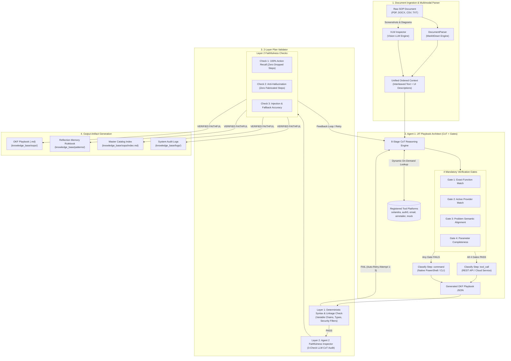

# SOP Ingestion Pipeline — Autonomous JIT Human SOP to OKF Playbook Engine

[](https://www.python.org/)
[](schemas/okf_schema.py)
[](core/plan_validator.py)
[](mcp_server.py)
[](test_standalone.py)

A self-contained ingestion engine that autonomously converts unstructured human Standard Operating Procedures (PDFs, Word documents with screenshots, plain text, and scanned pages) into deterministic, machine-executable **OKF (Operational Knowledge Framework) Playbooks** for L1 support agents. It ships as both a standalone Python package and a Model Context Protocol (MCP) server.

---

## Table of Contents

- [Features](#features)
- [Architecture](#architecture)
- [Installation](#installation)
- [Configuration](#configuration)
- [Quickstart & Usage](#quickstart--usage)
  - [1. CLI Runner](#1-cli-runner)
  - [2. Model Context Protocol (MCP) Server](#2-model-context-protocol-mcp-server)
  - [3. Python Package API](#3-python-package-api)
- [Generated Playbook Anatomy](#generated-playbook-anatomy)
- [Adding Custom Tool Platforms](#adding-custom-tool-platforms)
- [Project Structure](#project-structure)
- [Development & Testing](#development--testing)
- [Contributing](#contributing)
- [License](#license)

---

## Features

- **Multimodal Document Parsing**: Extracts text and embedded UI screenshots from Word (`.docx`) and `.pdf` files, using Vision-Language Models (VLM) to interleave visual interface context directly into procedural steps.
- **Dynamic On-Demand Tool Catalog**: Binds registered IT tools (`Solandra`, `Auth0`, `AirRetailer`, `Email`, `Mock`) on demand, reducing prompt bloat and cutting token overhead by ~40%.
- **4-Gate Procedural Matching**: Verifies action function matching, provider status, problem alignment, and parameter completeness to classify steps as API `tool_call` or native CLI `command`.
- **2-Layer Closed-Loop Validation**:
  - **Layer 1 (Deterministic)**: Fast (<1ms) syntax, regex, parameter completeness, and variable linkage check.
  - **Layer 2 (LLM Audit)**: Semantic audit checking 100% action recall, anti-hallucination, and prompt injection defense with an automatic 3-retry feedback loop.
- **Dual-Layer Playbooks**: Formats structured YAML frontmatter for agent runtimes and clean GitHub-Flavored Markdown for human L1/L2 engineers.
- **Native MCP 2.0 Server**: Standard stdio JSON-RPC server exposing SOP ingestion, validation, and catalog discovery to MCP clients (Antigravity IDE, Claude Desktop, Cursor).

---

## Architecture



---

## Installation

Clone the repository and set up a virtual environment:

```bash
# 1. Clone repository
git clone https://github.com/Cyberpradeep/Elone_Agent.git
cd Elone_Agent

# 2. Create and activate Python virtual environment
python -m venv .venv
# On Windows:
.\.venv\Scripts\activate
# On Linux/macOS:
# source .venv/bin/activate

# 3. Install core dependencies
pip install -r requirements.txt

# 4. (Optional) Install package in editable development mode
pip install -e .
```

---

## Configuration

Copy [`.env.example`](.env.example) to `.env` and fill in your API credentials:

```bash
cp .env.example .env
```

### Environment Variables

| Variable | Required | Description |
| :--- | :--- | :--- |
| `GOOGLE_API_KEY` | **Yes** | Google Gemini API key for JIT Converter execution planning. |
| `MISTRAL_API_KEY` | **Yes** | Mistral AI API key for Plan Validator Layer 2 faithfulness inspection. |
| `NVIDIA_API_KEY` | Optional | NVIDIA NIM API key for Multimodal VLM screenshot analysis. |
| `OPENROUTER_API_KEY` | Optional | Fallback multi-model API key. |
| `GROQ_API_KEY` | Optional | Groq API key for fast fallback inference. |
| `SOP_SCAN_INTERVAL_MINUTES` | Optional | Watcher polling interval in minutes (default: `10`). |
| `MAX_DAILY_CALLS` | Optional | Circuit-breaker max daily API calls cap (default: `50`). |

---

## Quickstart & Usage

### 1. CLI Runner

Convert SOP files or run the automated ingestion watcher:

```bash
# Convert a single raw SOP file
python run.py --file knowledge_base/_uploads/sample_account_unlock.txt

# Convert with custom SOP ID override
python run.py --file knowledge_base/_uploads/sample.pdf --sop-id SOP-AUTH-CUSTOM-001

# Run one full scan cycle over all files in _uploads/
python run.py --scan

# Start continuous folder watcher daemon (polls every 10 minutes)
python run.py --watch --interval 10

# Check active LLM models and provider mapping
python run.py --models
```

### 2. Model Context Protocol (MCP) Server

Launch the native MCP server to expose SOP ingestion tools to MCP-compatible hosts (Claude Desktop, Cursor, Antigravity):

```bash
# Run local CLI test harness verifying all MCP tools
python mcp_server.py --test

# Start stdio MCP Server
python mcp_server.py
```

#### MCP Client Configuration (`mcpServers` JSON block):

```json
{
  "mcpServers": {
    "elone-sop-ingestion": {
      "command": "python",
      "args": ["-m", "mcp_server"],
      "cwd": "/absolute/path/to/Elone_Agent"
    }
  }
}
```

#### Exposed MCP Tools:
- `ingest_sop(file_path, override_sop_id)`: Converts a raw document into a validated OKF playbook.
- `plan_sop(file_path)`: Read-only Phase 1 conversion drafting without disk writes.
- `validate_playbook_plan(raw_sop_text, steps_json)`: Runs Layer 1 and Layer 2 validation.
- `list_knowledge_base_playbooks()`: Returns the active knowledge base catalog index.
- `get_registered_tool_catalog()`: Returns the dynamic summary of registered tool platforms.
- `scan_uploads_now()`: Triggers an immediate scan of `knowledge_base/_uploads/`.
- `get_ingestion_scheduler_status()`: Returns background watcher status and metrics.

### 3. Python Package API

Import and use the pipeline directly inside any Python application:

```python
import elone_sop

# Convert a raw SOP document directly to disk
okf_path, frontmatter = elone_sop.convert_raw_sop_to_okf("knowledge_base/_uploads/sample_account_unlock.txt")
print(f"Generated Playbook: {okf_path}")

# Plan and draft without writing to disk (for human review)
draft = elone_sop.plan_okf_from_raw("knowledge_base/_uploads/sample_account_unlock.txt")

# Run 2-Layer Validation on steps
is_valid, errors = elone_sop.validate_plan_faithfulness_and_linkage(
    raw_sop_text="Step 1: Check network connectivity with ping.",
    execution_plan={"steps": [{"step_number": 1, "sop_step_description": "Ping host", "step_type": "command", "command": "ping 127.0.0.1"}]}
)
print(f"Plan Valid: {is_valid}")
```

---

## Generated Playbook Anatomy

Every generated OKF Playbook (`knowledge_base/sops/<category>/SOP-*.md`) contains machine-executable frontmatter and human-readable markdown:

```markdown
---
type: Playbook
sop_id: SOP-SOL-PWD-RESET-L1-002
title: Reset a Locked-Out User's Password via CoreID Admin Console
platform: solandra
category: logins
target_os: windows
description: Reset locked-out passwords using CoreID and verify caller identity.
confidence_score: 0.95
confidence_level: High
confidence_reason: All automated actions mapped directly to registered solandra tools.
required_entities:
  - employee_id
  - manager_name
  - department
trigger_words:
  - solandra
  - reset password
  - locked out
steps:
  - step_number: 1
    sop_step_description: User located and lock confirmed
    step_type: tool_call
    platform: solandra
    function_name: search_user
    comm_inputs:
      employee_id: '{{entities.employee_id}}'
    timeout_seconds: 30

  - step_number: 2
    sop_step_description: Verify caller identity and issue temporary password
    step_type: tool_call
    platform: solandra
    function_name: verify_caller_identity
    comm_inputs:
      user_id: '{{variables.user_details.user_id}}'
      employee_id: '{{entities.employee_id}}'
    execute_if: "variables.user_details.status == 'Locked'"
    timeout_seconds: 30
---

# Reset a Locked-Out User's Password Playbook

## Overview
When a user's self-service password reset fails, an authorized L1 agent verifies caller identity and issues a temporary password.

## Execution Steps
- **Step 1**: User located and lock confirmed [Platform: `solandra` | Tool Call: `solandra.search_user({"employee_id": "{{entities.employee_id}}"})`]
- **Step 2**: Verify caller identity [Platform: `solandra` | Tool Call: `solandra.verify_caller_identity(...)`]
```

---

## Adding Custom Tool Platforms

To register a new tool platform for automated agent matching:

1. Create a schema in [`tools/platforms/<platform_name>.py`](tools/platforms/).
2. Register it in [`tools/platforms/__init__.py`](tools/platforms/__init__.py) under `DETAILED_TOOL_SCHEMAS`.
3. Provide canonical function names, required inputs, and response schemas.

The pipeline will automatically index the new platform, making it discoverable during JIT conversion and validating it in Layer 1.

---

## Project Structure

```
Elone_Agent/
├── pyproject.toml              # PEP 621 Python Packaging & Entrypoints
├── requirements.txt            # Core dependencies
├── .env.example                # Environment variable configuration template
├── mcp_server.py               # Model Context Protocol (MCP) Server & CLI Test Harness
├── run.py                      # Standalone CLI runner (--file, --scan, --watch, --status)
├── debug_run.py                # Debug CLI runner with untruncated internal reasoning logs
├── scheduler.py                # Background folder watcher daemon
├── test_standalone.py          # Standalone test suite (32 passed, 0 failed)
│
├── elone_sop/                  # Top-Level Python Package Exports
│   └── __init__.py             # Public API functions, models, and schemas
│
├── config/                     # Configuration and LLM routing
│   ├── llm_config.py           # Multi-provider LLM factory (Gemini + Mistral fallback)
│   └── tool_catalog.py         # Static tool catalog schemas & summaries
│
├── core/                       # Ingestion & Translation Engine
│   ├── document_parser.py      # Multimodal MarkItDown + PyMuPDF + docx extractor
│   ├── input_validator.py      # Security gate: magic bytes, size cap, page limit
│   ├── jit_converter.py        # 8-Stage CoT Playbook Architect (Agent 1)
│   ├── plan_validator.py       # 2-Layer Linkage & Faithfulness Validator (Agent 2)
│   ├── link_scraper.py         # Web reference caching & HTML-to-Markdown extractor
│   └── vlm_inspector.py        # Vision LLM screenshot & diagram analyzer
│
├── gemini_monitor/             # Cost tracking & Daily Quota Guard
│   ├── monitor.py              # Circuit-breaker and usage tracker
│   ├── cost_calculator.py      # Token pricing & INR/USD cost calculator
│   └── daily_usage.json        # Atomic daily usage storage
│
├── prompts/                    # Prompts & Reasoning Mandates
│   ├── jit_converter_prompts.py # 8-Stage CoT & 4-Gate Converter Prompt
│   ├── validator_prompts.py    # 3-Check Faithfulness Inspector Prompt
│   └── vlm_prompts.py          # Multimodal UI Screenshot Extraction Prompt
│
├── schemas/                    # Pydantic Schemas
│   ├── okf_schema.py           # Pydantic v2 OKF step and playbook models
│   └── validator_schema.py     # Faithfulness inspection result schema
│
├── tools/                      # Tool definitions & Platform Schemas
│   ├── tool_functions.py       # LangChain dynamic tool definitions
│   ├── tool_schemas.py         # Re-exported schema mappings
│   ├── tool_validator_helpers.py # Layer 1 deterministic validation logic
│   └── platforms/              # Platform schemas (solandra, auth0, email, airretailer, mock)
│
└── knowledge_base/             # Knowledge repository
    ├── _uploads/               # INPUT: Drop raw SOP files (PDF, DOCX, CSV, TXT) here
    ├── sops/                   # OUTPUT: Generated OKF Playbooks categorized by domain
    ├── patterns/               # OUTPUT: Reflection rulebooks & learned constraints
    └── logs/                   # OUTPUT: Audit trails, parser dumps, and debug logs
```

---

## Development & Testing

Run the deterministic test suite:

```bash
python test_standalone.py
```

All 32 tests validate:
- Tool catalog loading, function lookup, and response schema checks.
- Pre-ingestion input validator gates (size caps, extension allowlists, magic bytes anti-spoofing).
- Prompt injection defense, regex security filters, and XML boundary protection.
- Layer 1 variable linkage, tool ownership boundary, and parameter validation.
- Gemini and Vision token pricing and circuit-breaker daily limit enforcement.

---

## Contributing

1. Fork the repository and create a feature branch (`git checkout -b feature/my-feature`).
2. Implement your changes following PEP 8 guidelines.
3. Run `python test_standalone.py` to ensure all 32 tests pass.
4. Commit your changes (`git commit -m "Add feature X"`) and push to your branch.
5. Open a Pull Request with a description of the changes and test results.

---

## License

Proprietary. Copyright © 2026 Elone Agent Team. All rights reserved.
