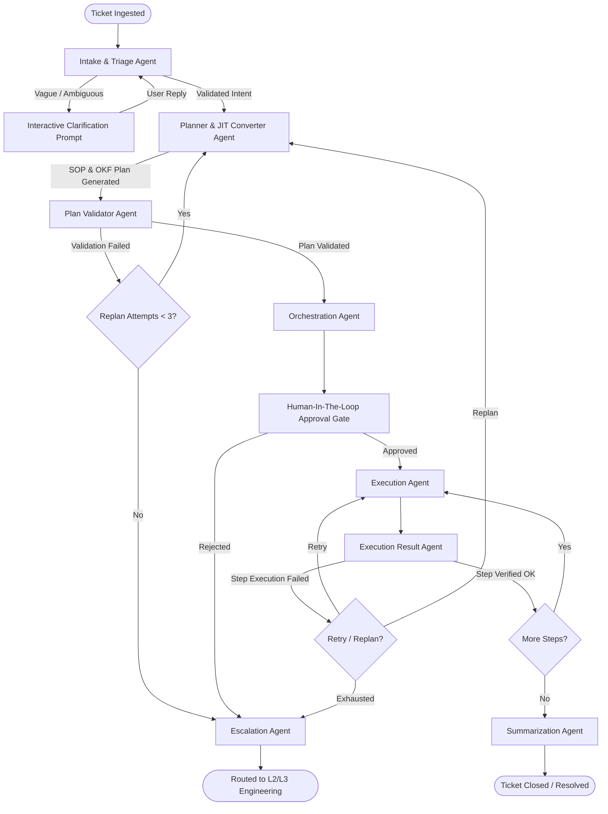
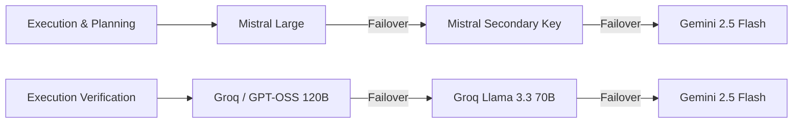

# EloneAgent: Autonomous L1 Support Agent Framework

<p align="center">
  
  
  
  
  
</p>

---

## Executive Summary

**EloneAgent** is an enterprise-grade autonomous L1 Tier support agent framework engineered to ingest customer support tickets, disambiguate vagueness through interactive UI prompts, fetch and parse Standard Operating Procedures (SOPs), generate verified execution plans, and execute multi-step remediation playbooks across local and remote environments.

Built on top of **LangGraph** and **FastAPI**, EloneAgent features a multi-agent orchestration architecture with dynamic LLM provider fallback routing, deterministic plan validation, human-in-the-loop (HITL) approval gates, per-step variable extraction, and structured L2/L3 escalation paths.

---

## System Architecture

The core framework operates as a stateful, directed acyclic graph (DAG) managed by LangGraph. Each node in the graph represents a specialized agent responsible for a distinct phase of the support resolution lifecycle.

### State Graph Workflow



---

## Core Multi-Agent Architecture

The table below outlines the specialized agents comprising the system graph and their specific technical responsibilities:

| Agent Component | Module File Path | Primary Technical Responsibility |
| :--- | :--- | :--- |
| **Intake Agent** | [`agents/intake/node.py`](agents/intake/node.py) | Classifies intent, extracts entities (IPs, emails, IDs), computes confidence metrics, and builds dynamic clarification UIs. |
| **Planner Agent** | [`agents/planner/node.py`](agents/planner/node.py) | Discovers relevant SOPs from knowledge base / OKF store, invokes JIT converter for unstructured documents, resolves variable bindings. |
| **JIT Converter** | [`agents/jit_converter/node.py`](agents/jit_converter/node.py) | Converts raw Markdown/PDF SOPs into structured Operational Knowledge Format (OKF) playbooks on the fly. |
| **Plan Validator** | [`agents/plan_validator/validator.py`](agents/plan_validator/validator.py) | Performs semantic faithfulness and parameter linkage verification to prevent command injection and broken dependency chains. |
| **Orchestration Agent** | [`agents/orchestration/node.py`](agents/orchestration/node.py) | Manages graph state transitions, tracks retry quotas, and handles workflow branch decisions. |
| **Execution Agent** | [`agents/execution/node.py`](agents/execution/node.py) | Executes shell commands, SSH scripts (Linux), WinRM scripts (Windows), or tool calls. Implements HITL approval breakpoint. |
| **Execution Result Agent** | [`agents/execution_result/node.py`](agents/execution_result/node.py) | Analyzes stdout, stderr, and exit codes per step. Resolves downstream variables from stdout via regex/JSON parsing. |
| **Summarization Agent** | [`agents/summarization/node.py`](agents/summarization/node.py) | Generates customer-facing resolution notifications and technical audit log summaries. |
| **Escalation Agent** | [`agents/escalation/node.py`](agents/escalation/node.py) | Compiles structured JSON escalation packages containing full diagnostic history, logs, and routing metadata for upper tiers. |

---

## Technical Features

> [!IMPORTANT]
> All execution actions marked with `is_dangerous: true` or containing sensitive operations pause execution and require explicit confirmation from a human operator prior to invocation.

### 1. Interactive Pre-SOP Intake Clarification
When a support ticket lacks critical diagnostic parameters (such as operating system version, deployment environment, or error codes), the **Intake Agent** generates a structured JSON schema specifying interactive frontend components (dropdowns, multi-selects, or text inputs). The graph pauses until the customer provides the required parameters, avoiding premature SOP lookup failures.

### 2. Operational Knowledge Format (OKF) Engine
The system utilizes a structured JSON playbook schema named **OKF (Operational Knowledge Format)**. Key attributes of OKF playbooks include:
- **Prerequisites & Conditions**: Validates pre-conditions before executing action sequences.
- **Parametrized Commands**: Step commands contain placeholder tokens (e.g., `{{email}}`, `{{user_id}}`) resolved dynamically at runtime.
- **Safety Flags & Fallbacks**: Each step defines `is_dangerous`, `danger_warning`, and optional fallback commands.

### 3. Human-In-The-Loop (HITL) Execution Engine
- Execution is configured with an explicit interrupt barrier (`interrupt_before=["execution_agent"]`).
- Operators can inspect the full step-by-step plan, modify proposed commands, edit descriptions, or reject execution via web console or CLI.
- Rejection automatically routes the ticket to the **Escalation Agent** with operator comments attached to the audit trail.

### 4. Dynamic Parameter Linkage & Result Reflection
- Step $N$ output (stdout, stderr, exit code) is evaluated immediately upon completion by the **Execution Result Agent**.
- Parsed parameters (e.g., process IDs, temporary access tokens, status flags) are committed to the graph state dictionary (`state["variables"]`) and automatically injected into Step $N+1$ placeholders.

### 5. Multi-Provider LLM Fallback Routing
To maintain high availability and mitigate API rate limits or outage events, the LLM router ([`shared/llm_config.py`](shared/llm_config.py)) implements provider fallback chains per agent role:



---

## Workspace Structure

```
l1_support_agent_code_only/
├── agents/                      # Specialized LangGraph agent nodes
│   ├── escalation/              # Escalation payload generation
│   ├── execution/               # Command execution (Local, SSH, WinRM)
│   ├── execution_result/        # Post-step verification & variable binding
│   ├── intake/                  # Ticket classification & clarification UI
│   ├── jit_converter/           # Unstructured SOP to OKF playbook converter
│   ├── orchestration/           # Graph state transition manager
│   ├── plan_validator/          # Deterministic safety & linkage validator
│   ├── planner/                 # Vector RAG SOP retriever & OKF mapper
│   └── summarization/           # Resolution & audit log generation
├── execution_tools/             # Remote & local execution engines
│   ├── comm_executor.py         # Subprocess command runner
│   ├── ssh_executor.py          # Paramiko SSH client provider
│   ├── winrm_executor.py        # PyWinRM client provider
│   └── variable_resolver.py     # Regex & JSON stdout parser
├── okf_engine/                  # Playbook loader & memory reflection logger
│   ├── loader.py                # OKF JSON schema loader & parser
│   └── memory_logger.py         # Device quirk & reflection logger
├── ingestion_pipe/              # Knowledge base ingestion & vector processing
│   ├── scheduler.py             # Automatic directory scanner & scheduler
│   └── validators.py            # Document parsing utilities
├── knowledge_base/              # Knowledge repository
│   ├── sops/                    # Categorized Markdown SOP files
│   └── _uploads/                # Staging directory for newly uploaded SOPs
├── shared/                      # System configuration & shared utilities
│   ├── llm_config.py            # Role-based LLM routing & fallback definitions
│   ├── state.py                 # SupportState TypedDict graph schema
│   ├── tool_catalog.py          # Integrated tool definitions & signatures
│   ├── tracing.py               # Arize Phoenix telemetry setup
│   └── ticket_logger.py         # Persistent session state logger
├── frontend/                    # Web application frontend assets
│   ├── index.html               # Real-time Ticket Console & HITL approval portal
│   ├── ingestion.html           # Ingestion Manager & SOP Upload GUI
│   └── js/                      # SSE streaming & dynamic UI scripts
├── evals/                       # Automated evaluation framework
│   ├── eval_dataset.json        # Test cases for benchmarking
│   └── run_evals.py             # Execution & scoring runner
├── tests/                       # Pytest unit & integration test suite
├── graph.py                     # Compiled LangGraph workflow instance
├── main.py                      # Interactive CLI entrypoint
├── run.py                       # Sample execution runner
├── server.py                    # FastAPI web server with REST & SSE endpoints
└── requirements.txt             # Python dependencies
```

---

## Installation & Setup

### Prerequisites
- Python 3.11 or higher
- Valid API keys for configured providers (Mistral, Google Gemini, Groq, OpenAI, or Ollama)

### 1. Clone Repository and Environment Setup

```bash
git clone <repository_url>
cd l1_support_agent_code_only
python -m venv .venv
```

Activate the virtual environment:
- **Windows (PowerShell)**: `.venv\Scripts\Activate.ps1`
- **Linux/macOS**: `source .venv/bin/activate`

### 2. Install Dependencies

```bash
pip install -r requirements.txt
```

### 3. Environment Configuration

Create a `.env` file in the root directory using the keys below:

```ini
# Primary LLM API Keys
MISTRAL_API_KEY=your_mistral_api_key
MISTRAL_API_KEY2=your_fallback_mistral_key
GOOGLE_API_KEY=your_google_gemini_api_key
GROQ_API_KEY=your_groq_api_key

# Local LLM Integration (Optional)
OLLAMA_BASE_URL=http://localhost:11434

# Embedding Model Configuration
HF_MODEL_NAME=sentence-transformers/all-MiniLM-L6-v2
CHUNK_SIZE=400
CHUNK_OVERLAP=60

# Observability & Tracing (Optional)
LANGCHAIN_TRACING_V2=true
LANGCHAIN_API_KEY=your_langchain_api_key
LANGCHAIN_PROJECT=Elone_L1_Support_Agent
```

---

## Operating Instructions

### Web Server & Dashboard (Recommended)

To start the FastAPI application server with real-time web UI support:

```bash
python server.py
```

The server listens on `http://localhost:8000`:
- **Ticket Resolution Console**: Open [`http://localhost:8000/frontend/index.html`](http://localhost:8000/frontend/index.html) in a browser.
- **SOP Ingestion Portal**: Open [`http://localhost:8000/frontend/ingestion.html`](http://localhost:8000/frontend/ingestion.html).
- **Interactive API Documentation**: Open [`http://localhost:8000/docs`](http://localhost:8000/docs).

### Interactive CLI Mode

For headless terminal operation and debugging:

```bash
python main.py
```

`main.py` initializes a sample ticket, executes the intake process, prompts for clarification if required, halts at the HITL breakpoint for user confirmation (`y/n`), and outputs the complete execution audit log.

### SOP Ingestion Scheduler

To run background scanning and ingestion of SOP documents placed in `knowledge_base/_uploads/`:

```python
from ingestion_pipe.scheduler import start_sop_ingestion_scheduler

# Scans directory every 60 seconds
start_sop_ingestion_scheduler(interval_seconds=60)
```

---

## API Endpoints Reference

The FastAPI server ([`server.py`](server.py)) exposes the following REST and SSE endpoints:

| Endpoint Path | HTTP Method | Payload / Parameters | Description |
| :--- | :--- | :--- | :--- |
| `/api/tickets` | `POST` | `NewTicketBody` JSON | Ingests a new ticket, creates a thread ID, and initiates graph execution. |
| `/api/tickets/{thread_id}` | `GET` | `thread_id` (Path) | Retrieves current graph state, workflow status, plan, and audit logs. |
| `/api/tickets/{thread_id}/clarify` | `POST` | `ClarifyBody` JSON | Submits user clarification choices to resume pending intake graphs. |
| `/api/tickets/{thread_id}/approve` | `POST` | `ApproveBody` JSON | Approves pending execution plans with optional step command overrides. |
| `/api/tickets/{thread_id}/reject` | `POST` | `RejectBody` JSON | Rejects execution plan, triggering immediate routing to Escalation. |
| `/api/stream/{thread_id}` | `GET` | `thread_id` (Path) | Server-Sent Events (SSE) stream delivering real-time graph node output. |
| `/api/sops/upload` | `POST` | Multipart Form File | Uploads raw Markdown/PDF SOPs to the ingestion pipeline directory. |
| `/api/sops/status` | `GET` | None | Returns background SOP ingestion scheduler status and vector index counts. |

---

## Testing & Evaluation Suite

> [!NOTE]
> All unit tests validate individual agent nodes, tool catalogs, plan linkers, and execution providers in isolation.

### Running Pytest Unit Tests

Execute the unit test suite across all agent modules:

```bash
# Windows (PowerShell with virtual environment activated)
python -m pytest tests/ -v

# Or directly referencing the virtual environment executable
.venv\Scripts\pytest tests/ -v

# Linux / macOS
PYTHONPATH=. pytest tests/ -v
```

### Running Automated Benchmark Evaluations

Evaluate ticket resolution precision, plan accuracy, and escalation compliance using the dataset in `evals/eval_dataset.json`:

```bash
python evals/run_evals.py
```

---

## Observability & Tracing

EloneAgent supports telemetry via **Arize Phoenix** and **LangChain Tracing**:

- Telemetry setup is initialized via [`shared/tracing.py`](shared/tracing.py).
- Spans track latency, token usage, LLM function call arguments, execution step exit codes, and agent routing logic.
- Local Phoenix tracing dashboard can be launched alongside graph execution to view full execution traces per thread ID.
