# Complete Low-Level Architectural Flowchart: Elone_Agent / Elone_Execution

This document details the end-to-end multi-agent execution pipeline, decision trees, guardrails, fallback cascades, and human-in-the-loop (HITL) checkpoints in **Elone_Agent**.

---

## 1. Visual Flowchart Diagram (Interactive Mermaid)

```mermaid
flowchart TD
    %% Global Styling
    classDef startEnd fill:#1e293b,stroke:#64748b,stroke-width:2px,color:#f8fafc;
    classDef agent fill:#0f172a,stroke:#38bdf8,stroke-width:2px,color:#f8fafc;
    classDef decision fill:#1e1b4b,stroke:#a855f7,stroke-width:2px,color:#f8fafc;
    classDef process fill:#022c22,stroke:#10b981,stroke-width:2px,color:#f8fafc;
    classDef hitl fill:#450a0a,stroke:#ef4444,stroke-width:2px,color:#f8fafc;
    classDef storage fill:#172554,stroke:#3b82f6,stroke-width:2px,color:#f8fafc;
    classDef comm fill:#311042,stroke:#e879f9,stroke-width:2px,color:#f8fafc;

    %% 0. Ingestion Layer
    subgraph S0 ["0. SOP Ingestion & Knowledge Base Pipeline"]
        direction TB
        SP_DOCS[("SharePoint / Uploads
_uploads/ (.docx, .pdf, .txt, .xlsx)")]:::storage
        SOP_INGEST["Ingestion Scheduler
(ingestion_pipe/scheduler.py)"]:::process
        OKF_GEN["JIT OKF Playbook Generator
(elone_sop / okf_engine)"]:::process
        VAL_PLAN["Faithfulness & Linkage Validator
(validate_plan_faithfulness_and_linkage)"]:::process
        OKF_STORE[("OKF Playbook Disk Store
knowledge_base/sops/{category}/*.md")]:::storage
        SOPS_CATALOG[("Master Catalog Index
knowledge_base/sops/index.md")]:::storage

        SP_DOCS -->|"Poll / File Watcher"| SOP_INGEST
        SOP_INGEST -->|"Convert raw procedure"| OKF_GEN
        OKF_GEN -->|"Validate syntax & parameters"| VAL_PLAN
        VAL_PLAN -->|"Save structured markdown"| OKF_STORE
        VAL_PLAN -->|"Register in catalog"| SOPS_CATALOG
    end

    %% 1. Ingress & Client Layer
    subgraph S1 ["1. Client Ingress & Event Streaming"]
        direction TB
        USER_UI(["Operator Web Console / REST API"]):::startEnd
        FASTAPI["FastAPI App (server.py)
POST /api/tickets"]:::process
        BG_THREAD["Background Graph Runner
_stream_worker (Thread Queue)"]:::process
        SSE_STREAM["Live SSE Stream
GET /api/tickets/{id}/stream"]:::comm

        USER_UI -->|"Submit Ticket Request"| FASTAPI
        FASTAPI -->|"Init SupportState"| BG_THREAD
        BG_THREAD -.->|"Realtime Event Updates"| SSE_STREAM
        SSE_STREAM -.->|"Live Dashboard UI"| USER_UI
    end

    %% 2. Intake & Triage Node
    subgraph S2 ["2. Intake Agent (agents/intake/node.py)"]
        direction TB
        ASSET_LOOKUP["Asset Lookup & Enrichment
(Asset Management - Sheet1.csv)"]:::process
        POLICY_GATE{"Allowed Software Policy?
(Allowed_Applications.csv)"}:::decision
        INTAKE_LLM["Triage LLM (Mistral / Gemini)
Intent & Entity Extraction"]:::agent
        CATALOG_SCAN["Master Catalog Scanner
(sops/index.md)"]:::process
        CLARIFY_CHECK{"Ambiguous / Missing
Information?"}:::decision
        ASK_CLARIFY["Set workflow_status='need_clarification'
Pause for Operator Input"]:::process

        BG_THREAD --> ASSET_LOOKUP
        ASSET_LOOKUP --> POLICY_GATE
        POLICY_GATE -->|"Unauthorized App / Unknown User"| ESCALATE_INTAKE["Flag for Escalation
(catalog_permission_approved=False)"]:::process
        POLICY_GATE -->|"Allowed Software"| INTAKE_LLM
        INTAKE_LLM --> CATALOG_SCAN
        CATALOG_SCAN --> CLARIFY_CHECK
        CLARIFY_CHECK -->|"Yes (is_ambiguous=True)"| ASK_CLARIFY
        CLARIFY_CHECK -->|"No (Confidence >= 0.7)"| GOTO_PLANNER[Route to planner_agent]:::process
        ESCALATE_INTAKE --> GOTO_ORCH_ESC[Route to orchestration_agent]:::process
    end

    %% 3. Unified Planner Node
    subgraph S3 ["3. Unified Planner Agent (agents/planner/node.py)"]
        direction TB
        DISCOVERY["Progressive Disclosure Discovery
(Matched Path -> Category Index -> Global Walk)"]:::process
        HOST_MEM[("Host Reflection Rules &
Device Quirks (/patterns/hosts/{hostname}.md)")]:::storage
        SOP_RULES[("SOP Reflection Rulebook
(/patterns/rules_{sop_id}.md)")]:::storage
        DEEP_COT["6-Stage Deep CoT Assembly
(Placeholder Binding: hostname, executable, email)"]:::agent
        PLAN_VALIDATOR{"Deterministic Plan Validator
(validate_planner_execution_plan)"}:::decision

        GOTO_PLANNER --> DISCOVERY
        DISCOVERY <--> OKF_STORE
        DISCOVERY --> HOST_MEM
        DISCOVERY --> SOP_RULES
        HOST_MEM --> DEEP_COT
        SOP_RULES --> DEEP_COT
        DEEP_COT --> PLAN_VALIDATOR
        PLAN_VALIDATOR -->|"Valid (plan_valid=True)"| GOTO_ORCH_PLAN[Route to orchestration_agent]:::process
        PLAN_VALIDATOR -->|"Invalid Plan / Missing Entities"| PLAN_REJECT["Mark plan_valid=False
validator_result=INVALID_PLAN"]:::process
        PLAN_REJECT --> GOTO_ORCH_PLAN
    end

    %% 4. Orchestration Node
    subgraph S4 ["4. Orchestration Agent (agents/orchestration/node.py)"]
        direction TB
        GUARDRAILS{"Check Escalation Guardrails
& Circuit Breakers"}:::decision
        SUCCESS_CHECK{"Is next_action
SUCCESS?"}:::decision
        RETRY_CHECK{"Is next_action
RETRY?"}:::decision
        STEP_ADVANCE{"All Plan Steps
Finished?"}:::decision
        FALLBACK_SWAP["Apply Fallback Command Swapping
Increment execution_retry_attempts"]:::process
        ADVANCE_INDEX["Advance current_step_index + 1
Reset retry count"]:::process

        GOTO_ORCH_PLAN --> GUARDRAILS
        GOTO_ORCH_ESC --> GUARDRAILS
        GUARDRAILS -->|"Circuit Breaker (Retries > 3 / Steps >= 15) or plan_valid=False"| ROUTE_ESCALATION[Route to escalation_agent]:::process
        GUARDRAILS -->|"Within Budget"| SUCCESS_CHECK

        SUCCESS_CHECK -->|"Yes"| STEP_ADVANCE
        STEP_ADVANCE -->|"Yes (All steps complete)"| ROUTE_SUMMARIZATION[Route to summarization_agent]:::process
        STEP_ADVANCE -->|"No (More steps remain)"| ADVANCE_INDEX
        ADVANCE_INDEX --> ROUTE_EXECUTION[Route to execution_agent]:::process

        SUCCESS_CHECK -->|"No"| RETRY_CHECK
        RETRY_CHECK -->|"Yes"| FALLBACK_SWAP
        FALLBACK_SWAP --> ROUTE_EXECUTION
        RETRY_CHECK -->|"Initial Step Dispatch"| ROUTE_EXECUTION
    end

    %% 5. Human-in-the-Loop Barrier
    subgraph S5 ["5. Human-in-the-Loop (HITL) Gate (interrupt_before)"]
        direction TB
        HITL_CHECK{"Is Plan Already Approved
or Mid-Execution Retry?"}:::decision
        HITL_PAUSE["Pause LangGraph Stream
Emit awaiting_approval=True"]:::hitl
        OPERATOR_ACTION{"Operator Choice
(Web UI)"}:::decision
        APPROVE_ACTION["POST /api/tickets/{id}/approve
Set is_human_approved=True"]:::process
        REJECT_ACTION["POST /api/tickets/{id}/reject
Set is_human_rejected=True"]:::process

        ROUTE_EXECUTION --> HITL_CHECK
        HITL_CHECK -->|"First Step & Not Approved"| HITL_PAUSE
        HITL_CHECK -->|"Approved / Step > 0 / Retry"| EXEC_START[Proceed to Execution]:::process

        HITL_PAUSE -.->|"Awaiting Decision"| OPERATOR_ACTION
        OPERATOR_ACTION -->|"Approve Plan / Edits"| APPROVE_ACTION
        OPERATOR_ACTION -->|"Reject Plan"| REJECT_ACTION

        APPROVE_ACTION --> EXEC_START
        REJECT_ACTION --> ROUTE_ESCALATION
    end

    %% 6. Execution Node
    subgraph S6 ["6. Execution Agent (agents/execution/node.py)"]
        direction TB
        PRECOND_CHECK{"Precondition Check
(execute_if evaluation)"}:::decision
        STEP_TYPE{"Step Type"}:::decision
        LOCAL_CHECK{"Is Target Host
Local Machine?"}:::decision
        LOCAL_EXEC["Local Subprocess Fast-Path
powershell.exe (0ms Network Overhead)"]:::process
        REMOTE_EXEC["Remote Runner (Paramiko SSH / WinRM)
Host Resolution (.local / mDNS)"]:::process
        TOOL_EXEC["API Tool Runner (tool_runner.py)
(Auth0 / Okta / Mock / Solandra / Email)"]:::process
        EXEC_FALLBACK{"Exit Code != 0 and
fallback_command exists?"}:::decision
        RUN_FALLBACK["Run Step-Level Fallback Command"]:::process

        EXEC_START --> PRECOND_CHECK
        PRECOND_CHECK -->|"Condition False"| SKIP_STEP["Skip Step
(next_action='SUCCESS')"]:::process
        PRECOND_CHECK -->|"Condition True / None"| STEP_TYPE

        STEP_TYPE -->|"Command Step"| LOCAL_CHECK
        STEP_TYPE -->|"Tool Call Step"| TOOL_EXEC
        STEP_TYPE -->|"Communication Step"| COMM_EXEC["Email Dispatcher (comm_executor.py)"]:::comm

        LOCAL_CHECK -->|"Matches Local Computername / IP"| LOCAL_EXEC
        LOCAL_CHECK -->|"Remote Workstation / IP"| REMOTE_EXEC

        LOCAL_EXEC --> EXEC_FALLBACK
        REMOTE_EXEC --> EXEC_FALLBACK
        EXEC_FALLBACK -->|"Yes"| RUN_FALLBACK
        EXEC_FALLBACK -->|"No"| GOTO_VERIFY[Route to execution_result_agent]:::process
        RUN_FALLBACK --> GOTO_VERIFY
        TOOL_EXEC --> GOTO_VERIFY
        COMM_EXEC --> GOTO_VERIFY
    end

    %% 7. Execution Result Verifier Node
    subgraph S7 ["7. Execution Result Agent (agents/execution_result/node.py)"]
        direction TB
        JSON_FAST_CHECK{"Is JSON Output
or Tool Response?"}:::decision
        FAST_JSON_PARSE["Fast Structural JSON Parser (Sub-Millisecond)
Direct Key & Nested Array Extraction"]:::process
        REMOVAL_CHECK{"Is Successful Deletion /
Removal Verification?"}:::decision
        LLM_COT_VERIFY["LLM CoT Result Analyzer
(evaluates output_parse_instruction)"]:::agent
        VAR_MERGE["Merge Extracted Variables into
state.variables & state.entities"]:::storage
        VERDICT_SET["Set next_action verdict
(SUCCESS / RETRY / ESCALATE)"]:::process

        GOTO_VERIFY --> JSON_FAST_CHECK
        SKIP_STEP --> GOTO_ORCH_RETURN[Return to orchestration_agent]:::process
        JSON_FAST_CHECK -->|"Yes"| FAST_JSON_PARSE
        JSON_FAST_CHECK -->|"No (CLI stdout/stderr)"| REMOVAL_CHECK
        REMOVAL_CHECK -->|"Exit Code=0 or Valid Removal"| LLM_COT_VERIFY
        FAST_JSON_PARSE --> VAR_MERGE
        LLM_COT_VERIFY --> VAR_MERGE
        VAR_MERGE --> VERDICT_SET
        VERDICT_SET --> GOTO_ORCH_RETURN
        GOTO_ORCH_RETURN --> GUARDRAILS
    end

    %% 8. Escalation Node
    subgraph S8 ["8. Escalation Agent (agents/escalation/node.py)"]
        direction TB
        BUILD_HANDOVER["Generate L2/L3 Escalation Handover Package
(Captured stdout/stderr, Root Cause, Entity Dumps)"]:::process
        GOTO_SUMM_FROM_ESC[Route to summarization_agent]:::process

        ROUTE_ESCALATION --> BUILD_HANDOVER
        BUILD_HANDOVER --> GOTO_SUMM_FROM_ESC
    end

    %% 9. Summarization Node
    subgraph S9 ["9. Summarization Agent (agents/summarization/node.py)"]
        direction TB
        SUMM_TIER1{"Tier 1: Structured Pydantic LLM
(Gemini / Mistral / Groq)"}:::decision
        SUMM_TIER2{"Tier 2: Raw JSON Parsing Fallback"}:::decision
        SUMM_TIER3["Tier 3: Programmatic Rich Markdown Generator
(Guaranteed 100% Reliability)"]:::process
        GEN_OUTPUTS["Generate Outputs:
1. Customer Email Reply
2. Internal Technical Markdown Summary"]:::process
        EPISODIC_LOG[("Episodic Execution Trace Logger
knowledge_base/patterns/logs/YYYY-MM/...")]:::storage
        WORKFLOW_END(["__end__ (Workflow Complete / FULLY_RESOLVED / ESCALATED)"]):::startEnd

        ROUTE_SUMMARIZATION --> SUMM_TIER1
        GOTO_SUMM_FROM_ESC --> SUMM_TIER1

        SUMM_TIER1 -->|"Success"| GEN_OUTPUTS
        SUMM_TIER1 -->|"Fallback"| SUMM_TIER2
        SUMM_TIER2 -->|"Success"| GEN_OUTPUTS
        SUMM_TIER2 -->|"Fallback"| SUMM_TIER3
        SUMM_TIER3 --> GEN_OUTPUTS

        GEN_OUTPUTS --> EPISODIC_LOG
        EPISODIC_LOG --> WORKFLOW_END
    end

```

---

## 2. Component-by-Component Low-Level Walkthrough

### 0. SOP Ingestion & Knowledge Base Pipeline (`ingestion_pipe/`, `okf_engine/`)
* **SharePoint / Local Ingestion (`ingestion_pipe/scheduler.py`):** Automatically polls SharePoint folders and `_uploads/` for new `.docx`, `.pdf`, `.txt`, or raw markdown procedures.
* **OKF Converter (`elone_sop` / `okf_engine`):** Standardizes unstructured procedures into Open Knowledge Framework (OKF) markdown playbooks featuring structured metadata, step commands, `output_parse_instruction`, and `execute_if` triggers.
* **Master Catalog Index (`knowledge_base/sops/index.md`):** Maintains human-readable catalog routes for rapid lookup without token cost.
* **Disk Store (`knowledge_base/sops/`):** Organizes OKF playbooks into category folders for progressive disclosure discovery.

### 1. Ingress & Event Streaming Layer (`server.py`, `frontend/`)
* **FastAPI Server (`server.py`):** Accepts tickets via `POST /api/tickets`, initializes `SupportState`, and launches background `_stream_worker` execution threads.
* **Server-Sent Events (SSE) Stream (`/api/tickets/{thread_id}/stream`):** Pushes real-time graph state updates (`node_start`, `node`, `paused`, `done`) directly to the single-page frontend.

### 2. Intake & Triage Agent (`agents/intake/`)
* **Asset Identification (`shared/asset_lookup.py`):** Matches caller email against `Asset Management - Sheet1.csv` to enrich hostname, device ID, username, and password credentials.
* **Policy Compliance Gate:** Checks `Allowed_Applications.csv` to ensure software requests are pre-authorized for the user. Unauthorized requests are routed immediately to escalation.
* **LLM Triage (`agents/intake/llm.py`):** Classifies intent, category, and priority using Mistral / Gemini fallbacks.
* **Catalog Scanner:** Scans `sops/index.md` for matching playbooks.
* **Clarification Engine:** If required information is missing, sets `workflow_status = "need_clarification"` and presents structured dropdown/text prompts to the operator.

### 3. Unified Planner Agent (`agents/planner/`)
* **Progressive Disclosure Discovery (`agents/planner/discovery.py`):** Resolves OKF playbooks from matched file path, category index, or global disk traversal.
* **Episodic & Reflection Memory Retrieval (`knowledge_base/patterns/`):** Fetches host-specific device quirks (`patterns/hosts/{hostname}.md`) and verified recovery rules (`patterns/rules_{sop_id}.md`).
* **6-Stage Deep CoT Plan Assembly (`agents/planner/binder.py`):** Binds static entities (`{hostname}` -> `DESKTOP-O9HENH2`, `{executable}` -> `Code.exe`) and validates variable linkage across step dependencies.
* **Deterministic Layer 1 Validator (`validate_planner_execution_plan`):** Verifies execution plan validity before dispatching.

### 4. Orchestration Agent (`agents/orchestration/`)
* **Circuit Breakers & Guardrails (`agents/orchestration/guardrails.py`):** Enforces hard limits:
  * Maximum 3 step retry attempts.
  * Maximum 15 total step executions per ticket.
* **Success & Step Advancement:** Advances `current_step_index` and routes to `summarization_agent` once all steps succeed.
* **Retry & Fallback Swapping (`agents/orchestration/fallback.py`):** On `RETRY`, swaps step commands with `fallback_command` or re-plans using `fallback_sop_id`.

### 5. Human-in-the-Loop (HITL) Gate (`interrupt_before=["execution_agent"]`)
* **Pre-Execution Plan Approval:** Pauses the graph before Step 1 to allow the human operator to inspect and edit commands before execution.
* **Seamless Auto-Continue:** When prior approval (`is_human_approved=True` or `current_step_index > 0`) is present, mid-execution interrupts and automatic step retries execute seamlessly without false pauses.

### 6. Execution Agent (`agents/execution/`)
* **Precondition Evaluator (`agents/execution/conditions.py`):** Evaluates `execute_if` (e.g. `variables.app_running == true`). Skips step if false.
* **Execution Router (`execution_tools/`):**
  * **Local Host Fast-Path:** Executes directly via native PowerShell (`subprocess.run`) with 0ms network overhead when hostname matches local PC.
  * **Remote Host Runner:** Connects over **Paramiko SSH** (Port 22) or **PyWinRM** (Port 5985) with automatic mDNS resolution.
  * **API Tool Runner:** Executes enterprise identity tools (Auth0, Okta, Mock Admin Console, Solandra).

### 7. Execution Result Verifier Agent (`agents/execution_result/`)
* **Fast Structural JSON Parser:** Evaluates structured API responses in `< 1ms`.
* **LLM CoT Output Verifier (`agents/execution_result/extractor.py`):** Evaluates conditional parse rules, extracts dynamic variables into snake_case keys (PIDs, IPs, status flags), and assigns `SUCCESS`, `RETRY`, or `ESCALATE`.

### 8. Escalation Agent (`agents/escalation/`)
* **Handover Synthesizer:** Assembles a structured L2/L3 escalation packet containing command traces, error logs, and root cause notes.

### 9. Summarization Agent (`agents/summarization/`)
* **3-Tier Resilient Generation:**
  * **Tier 1:** Structured Pydantic LLM Output (Gemini / Mistral / Groq).
  * **Tier 2:** Raw JSON block extraction fallback.
  * **Tier 3:** Deterministic rich programmatic Markdown generator.
* **Episodic Trace Logging (`okf_engine/memory_logger.py`):** Stores completed ticket traces into `knowledge_base/patterns/logs/YYYY-MM/` for future retrieval and few-shot learning.
