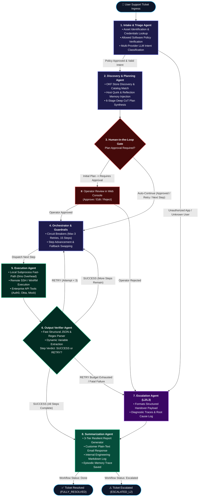

# High-Level Architecture Flowchart: Elone_Agent

This document provides a high-level executive overview of the **Elone_Agent** autonomous IT support automation workflow.

---

## 1. High-Level Flowchart Diagram (Interactive Mermaid)

---

## 2. Key High-Level Phases

| Phase | Agent / Component | High-Level Purpose |
| :--- | :--- | :--- |
| **1. Intake & Triage** | `intake_agent` | Identifies caller email, enriches hostname & credentials from asset sheets, checks software authorization, and classifies intent. |
| **2. Discovery & Planning** | `planner_agent` | Discovers OKF playbooks from knowledge base catalog and store, applies host reflection memory, and generates an executable step-by-step plan. |
| **3. Human-in-the-Loop** | `HITL Gate` | Halts execution before Step 1 for operator inspection and approval; automatically continues subsequent steps and retries once approved. |
| **4. Orchestrator** | `orchestration_agent` | Enforces circuit breakers (max 3 retries, max 15 steps) and routes traffic between steps, retries, and escalation. |
| **5. Execution** | `execution_agent` | Runs native PowerShell commands locally with 0ms network overhead, connects to remote machines via SSH/WinRM, or calls enterprise identity API tools. |
| **6. Output Verification** | `execution_result_agent` | Verifies command exit codes, parses structured JSON, extracts dynamic state variables (e.g. IPs, PIDs, status flags), and determines step success. |
| **7. Escalation** | `escalation_agent` | Assembles a structured L2/L3 handover ticket with full failure logs, error snippets, and diagnostic findings. |
| **8. Summarization** | `summarization_agent` | Generates a user-facing resolution email, an internal technical engineering report, and stores the episodic memory trace on disk. |
