# Complete Low-Level Ingestion Pipeline Flowchart & Architecture

---

## 1. Native Interactive Mermaid Diagram

```mermaid
flowchart TD
    classDef inputNode fill:#EBF3FB,stroke:#1B365D,stroke-width:2px,color:#1B365D;
    classDef gateNode fill:#FFF8E7,stroke:#D97706,stroke-width:2px,color:#92400E;
    classDef parseNode fill:#F0FDF4,stroke:#16A34A,stroke-width:2px,color:#166534;
    classDef llmNode fill:#F5F3FF,stroke:#7C3AED,stroke-width:2px,color:#5B21B6;
    classDef valNode fill:#FEF2F2,stroke:#DC2626,stroke-width:2px,color:#991B1B;
    classDef successNode fill:#ECFDF5,stroke:#059669,stroke-width:2px,color:#065F46;
    classDef rejectNode fill:#FFF1F2,stroke:#E11D48,stroke-width:2px,color:#9F1239;

    subgraph PHASE1 [PHASE 1: INGESTION TRIGGER AND PRE-CHECKS]
        Upload["Raw SOP Document Upload<br/>.pdf, .docx, .csv, .xlsx, .txt"]:::inputNode
        Scheduler["Scheduler Polling Worker<br/>knowledge_base/_uploads/"]:::inputNode
        
        Upload --> Gate1["GATE 1: Pre-Ingestion File Validator<br/>core/input_validator.py"]:::gateNode
        Scheduler --> Gate1
        
        Gate1 --> CheckExt{"1. Allowed Extension?<br/>.pdf, .docx, .csv, .xlsx, .txt"}
        CheckExt -->|No| RejectExt["Reject: Unsupported Format"]:::rejectNode
        CheckExt -->|Yes| CheckMagic{"2. Magic-Bytes Valid?<br/>Reject .exe or .dll disguised as doc"}
        
        CheckMagic -->|No or Spoofed| RejectMagic["Reject: File Spoofing Detected"]:::rejectNode
        CheckMagic -->|Yes| CheckSize{"3. Size and Page Caps?<br/>Max 10MB, 10 Pages, 5000 Words"}
        
        CheckSize -->|Exceeded| RejectSize["Reject: Size or Page Cap Exceeded"]:::rejectNode
        CheckSize -->|Yes| CheckZip{"4. Zip Bomb Ratio?<br/>Max 50MB uncompressed, ratio max 20x"}
        
        CheckZip -->|Decompression Bomb| RejectZip["Reject: Bomb or Memory Threat"]:::rejectNode
    end

    subgraph PHASE2 [PHASE 2: DOCUMENT-ORDER EXTRACTION AND DATA ENRICHMENT]
        CheckZip -->|Passed All Pre-Checks| DocParser["Document Parser and Physical Walk<br/>core/document_parser.py"]:::parseNode
        
        DocParser --> StreamText["Stream 1: Ordered Text Segments"]
        DocParser --> StreamImg["Stream 2: Embedded Screenshots and Images"]
        DocParser --> StreamLink["Stream 3: External Web Hyperlinks"]
        
        StreamText --> Gate2["GATE 2: Text and DLP Sanitizer<br/>Mask Passwords, API Keys, Emails<br/>Strip Zero-Width Unicode and BiDi Overrides"]:::gateNode
        
        StreamImg --> Gate3["GATE 3: VLM Vision Security<br/>Pixel Bomb Cap Max 4096px<br/>Downscale to 1024px JPEG Anti-Bloat<br/>Vision LLM extracts UI labels OCR"]:::gateNode
        
        StreamLink --> Gate4["GATE 4: SSRF and Web Quarantine<br/>Scrape cache to disk Max 4KB<br/>Excluded from direct prompt Anti-Injection"]:::gateNode
        
        Gate2 --> Splicer["Ordered Context Splicer<br/>Interleaves Text and Vision Reports"]:::parseNode
        Gate3 --> Splicer
        Gate4 -.-> Splicer
    end

    subgraph PHASE3 [PHASE 3: JIT CONVERTER AGENT AND REASONING]
        Splicer --> TriageRouter["Stage 1: Triage Router LLM<br/>gemini-2.5-flash or mistral-small<br/>Inspects dynamic platform tools"]:::llmNode
        
        TriageRouter --> TriageDecision{"Classification Paradigm?"}
        TriageDecision -->|unactionable| InformationalExit["Stage 1 Early Exit:<br/>Save Informational Metadata"]:::rejectNode
        
        TriageDecision -->|command| CmdPrompt["Select COMMAND_COT_PROMPT<br/>Pure PowerShell Focus"]:::llmNode
        TriageDecision -->|tool_call| ToolPrompt["Select TOOL_COT_PROMPT<br/>Cloud and REST API Focus"]:::llmNode
        TriageDecision -->|hybrid| HybridPrompt["Select HYBRID_COT_PROMPT<br/>PowerShell and API Focus"]:::llmNode
        
        CmdPrompt --> PromptSandbox["GATE 5: Prompt Sandboxing<br/>Wrap in untrusted_document_payload<br/>Escape closing XML delimiter tags<br/>Enforce passive data contract"]:::gateNode
        ToolPrompt --> PromptSandbox
        HybridPrompt --> PromptSandbox
        
        PromptSandbox --> ConverterLLM["Converter Agent LLM<br/>gemini-2.5-flash or mistral-small<br/>Executes 6-Stage CoT Reasoning"]:::llmNode
        
        ConverterLLM --> CandidateJSON["Generated Candidate OKF Playbook JSON"]:::inputNode
    end

    subgraph PHASE4 [PHASE 4: DUAL-LAYER VALIDATION AND GUARDRAILS]
        CandidateJSON --> Layer1["GATE 6.1: Deterministic AST and Blacklist Scan<br/>core/plan_validator.py<br/>Check empty or placeholder steps<br/>Verify required_entities consistency<br/>Ban LOLBins: certutil, bitsadmin, mshta<br/>Ban Encoded PowerShell: -enc<br/>Ban backdoor user creation: net user /add<br/>Double-quote variable placeholders"]:::valNode
        
        Layer1 --> Layer1Check{"Layer 1 Passed?"}
        
        Layer1Check -->|No| RetryLoop["Auto-Retry Controller<br/>Up to 3 Retry Attempts<br/>Injects specific error feedback"]:::rejectNode
        RetryLoop -->|Feed Error Directives| PromptSandbox
        
        Layer1Check -->|Yes| Layer2["GATE 6.2: LLM Faithfulness and Injection Audit<br/>mistral-small-latest<br/>100% Action and tool recall inspection<br/>Hallucination and fabrication detection<br/>Adversarial prompt injection scan<br/>Confidence scoring: High >= 0.85"]:::valNode
        
        Layer2 --> Layer2Check{"Layer 2 Passed?"}
        Layer2Check -->|No or Injection Detected| RetryLoop
    end

    subgraph PHASE5 [PHASE 5: CRYPTOGRAPHIC INTEGRITY AND STORAGE]
        Layer2Check -->|PASSED - 1.00 High| Gate7["GATE 7: Storage Sandbox and Integrity<br/>SOP ID alphanumeric whitelist slugging<br/>Embed HMAC-SHA256 digital stamp<br/>Auto-init Reflection Rulebook: patterns/<br/>Write audit log: tokens, latency, cost"]:::gateNode
        
        Gate7 --> FinalPlaybook["VERIFIED EXECUTABLE OKF PLAYBOOK<br/>knowledge_base/sops/category/SOP-ID.md<br/>Ready for live Execution Dispatcher"]:::successNode
    end

```

---

## 2. Interactive Browser App
You can open [`INGESTION_PIPELINE_INTERACTIVE_FLOWCHART.html`](../INGESTION_PIPELINE_INTERACTIVE_FLOWCHART.html) in your browser for a **full-screen interactive experience with Pan, Zoom, and Stage Highlighting**.
