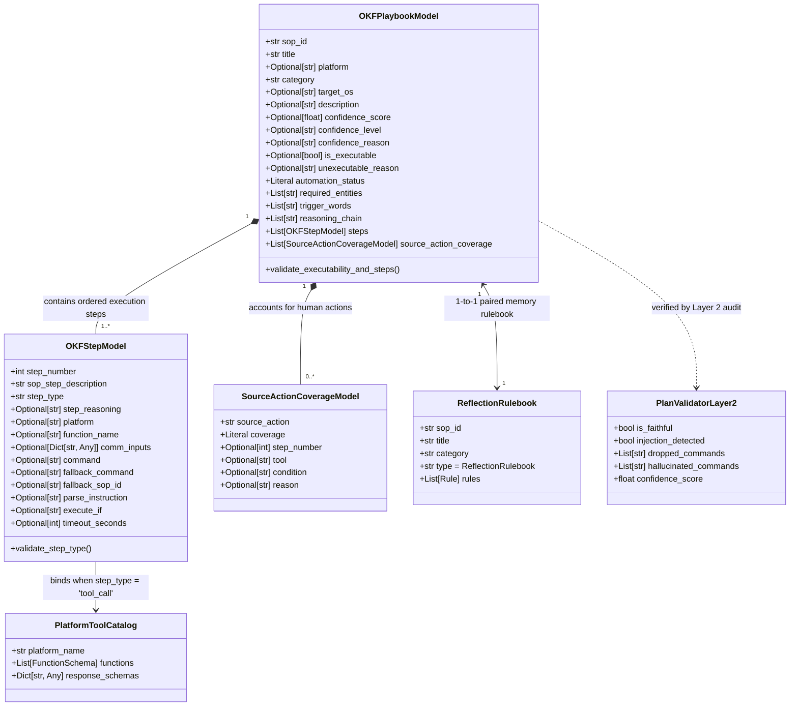
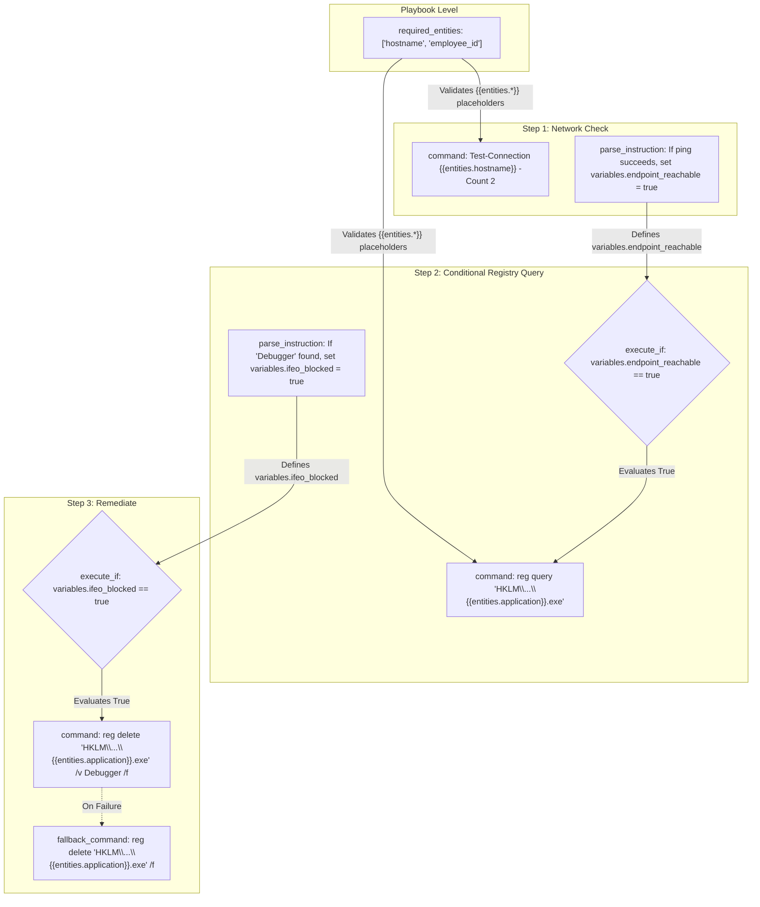
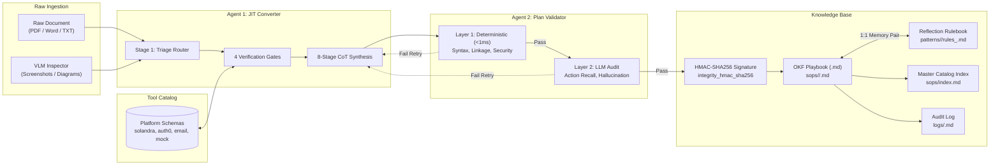
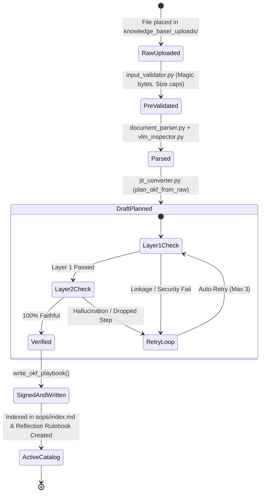

# Operational Knowledge Framework (OKF) — Structure & Relationships

---

## 1. Executive Summary

In the **Elone Agent** ingestion and execution architecture, **OKF (Operational Knowledge Framework)** is the canonical representation schema and runtime contract. 

Human Standard Operating Procedures (SOPs)—originating as messy PDFs, Word documents with screenshots, plain text, or scanned images—are autonomously compiled by the JIT (Just-In-Time) converter into deterministic, machine-executable **OKF Playbooks**.

An OKF Playbook bridges two worlds:
1. **Machine-Executable Contract (YAML Frontmatter)**: Strictly validated by Pydantic, digitally signed with HMAC-SHA256, and consumable by automated L1/L2 agent runtimes.
2. **Human-Readable Documentation (Markdown Body)**: Clean, styled documentation for human engineers and auditors detailing procedural steps, fallbacks, and parameter bindings.

---

## 2. Master OKF Entity-Relationship Diagram



---

## 3. Physical File Structure & Dual-Layer Anatomy

All generated OKF playbooks reside under:
`knowledge_base/sops/<category>/<sop_id>.md`

### File Layout
```
knowledge_base/sops/<category>/<sop_id>.md
├── ─── [START YAML FRONTMATTER: Machine-Executable Schema]
│   ├── Metadata (sop_id, title, platform, category, target_os)
│   ├── Automation Status & Confidence Score
│   ├── required_entities: [hostname, application, ...]
│   ├── trigger_words: [ifeo, unblock, ...]
│   ├── steps: (Array of OKFStepModel)
│   ├── source_action_coverage: (Array of SourceActionCoverageModel)
│   ├── integrity_version: "v2"
│   └── integrity_hmac_sha256: "<64-char-hex-hash>"
├── ─── [END YAML FRONTMATTER]
└── [START MARKDOWN BODY: Human-Readable Guide]
    ├── # <Title> Playbook
    ├── ## Overview
    └── ## Execution Steps (Formatted CLI / API calls with fallbacks)
```

### Concrete Playbook Example ([`knowledge_base/sops/software/SOP-L1-APP-001.md`](file:///d:/Projects/Elone/Elone_Agent/knowledge_base/sops/software/SOP-L1-APP-001.md))

```yaml
---
type: Playbook
sop_id: SOP-L1-APP-001
title: Software Application Unblock Request
platform: system
category: software
target_os: windows
description: Automated workflow to verify endpoint connectivity, inspect registry for IFEO Debugger blocks, remove the block, refresh policy, and verify removal.
confidence_score: 0.98
confidence_level: High
confidence_reason: All steps mapped to deterministic Windows PowerShell commands with exact variable linkage.
is_executable: true
unexecutable_reason: null
required_entities:
- hostname
- application
trigger_words:
- ifeo
- unblock
- application
- debugger
- registry
steps:
- step_number: 1
  sop_step_description: Verify endpoint network connectivity before performing remote diagnostics.
  step_type: command
  platform: null
  function_name: null
  comm_inputs: null
  command: Test-Connection {{entities.hostname}} -Count 2
  fallback_command: null
  fallback_sop_id: null
  parse_instruction: If ping replies are received, set variables.endpoint_reachable = true, else set variables.endpoint_reachable = false
  execute_if: null
  timeout_seconds: 30
  shell: powershell
- step_number: 2
  sop_step_description: Query IFEO registry key to check if application is blocked by a Debugger entry.
  step_type: command
  platform: null
  function_name: null
  comm_inputs: null
  command: reg query "HKLM\SOFTWARE\Microsoft\Windows NT\CurrentVersion\Image File Execution Options\{{entities.application}}.exe"
  fallback_command: null
  fallback_sop_id: null
  parse_instruction: If stdout contains 'Debugger', set variables.ifeo_blocked = true, else set variables.ifeo_blocked = false
  execute_if: variables.endpoint_reachable == true
  timeout_seconds: 30
  shell: powershell
integrity_version: v2
integrity_hmac_sha256: c07a11e714fa5d78ad7f7f04dc1b8cf11bd688ad8f4ebf360cea05889797b5e4
---

# Software Application Unblock Request Playbook

## Overview
Automated workflow to verify endpoint connectivity, inspect registry for IFEO Debugger blocks, remove the block, refresh policy, and verify removal.

## Execution Steps
- **Step 1**: Verify endpoint network connectivity before performing remote diagnostics. (`Test-Connection {{entities.hostname}} -Count 2`)
- **Step 2**: Query IFEO registry key to check if application is blocked by a Debugger entry. (`reg query "HKLM\SOFTWARE\Microsoft\Windows NT\CurrentVersion\Image File Execution Options\{{entities.application}}.exe"`)
```

---

## 4. Schema Specifications ([`schemas/okf_schema.py`](file:///d:/Projects/Elone/Elone_Agent/schemas/okf_schema.py))

### 4.1. `OKFPlaybookModel`

| Field | Type | Description |
| :--- | :--- | :--- |
| `sop_id` | `str` | Unique, sanitized slug ID (e.g., `SOP-L1-APP-001`, `SOL-PWD-RESET-L1-002`). |
| `title` | `str` | Human-readable title of the playbook. |
| `platform` | `Optional[str]` | Target system platform (`system`, `solandra`, `auth0`, `airretailer`). |
| `category` | `str` | Ingestion folder category (`software`, `password_reset`, `network`). |
| `target_os` | `Optional[str]` | Target OS environment (`windows`, `cross-platform`). Defaults to `"windows"`. |
| `description` | `Optional[str]` | Operational scope summary. |
| `confidence_score` | `Optional[float]` | Conversion fidelity score ($0.0$ to $1.0$). |
| `confidence_level` | `Optional[str]` | Categorical rating: `"High"`, `"Medium"`, or `"Low"`. |
| `confidence_reason` | `Optional[str]` | CoT rationale justifying the assigned confidence score. |
| `is_executable` | `Optional[bool]` | Whether the document represents an automated procedure (`True`/`False`). |
| `unexecutable_reason` | `Optional[str]` | Explanation when document is informational or not actionable. |
| `automation_status` | `Literal` | `"fully_automated"`, `"partially_automated"`, or `"needs_review"`. |
| `required_entities` | `List[str]` | Dynamic entity parameters required at execution time (e.g., `hostname`, `employee_id`). |
| `trigger_words` | `List[str]` | Lookup tags for the agent runtime intent matcher. |
| `reasoning_chain` | `List[str]` | Internal 8-stage CoT trace (stripped prior to disk write). |
| `steps` | `List[OKFStepModel]` | Sequential execution steps (must have $\ge 1$ step if `is_executable=True`). |
| `source_action_coverage` | `List[SourceActionCoverageModel]` | Action accounting ledger ensuring 100% human instruction recall. |

---

### 4.2. `OKFStepModel`

| Field | Type | Validation / Description |
| :--- | :--- | :--- |
| `step_number` | `int` | 1-indexed execution sequence number. |
| `sop_step_description` | `str` | Concise, imperative action summary. |
| `step_type` | `str` | Must be either `'tool_call'` or `'command'`. |
| `step_reasoning` | `Optional[str]` | LLM rationale for gate decisions (stripped from persisted YAML). |
| `platform` | `Optional[str]` | Platform target for tool calls (`solandra`, `auth0`, etc.). |
| `function_name` | `Optional[str]` | Tool function name (required if `step_type='tool_call'`). |
| `comm_inputs` | `Optional[Dict[str, Any]]` | Parameters passed to API tool. Supports `{{entities.*}}` and `{{variables.*}}`. |
| `command` | `Optional[str]` | Shell command string (required if `step_type='command'`). |
| `fallback_command` | `Optional[str]` | Alternative command invoked if primary fails. |
| `fallback_sop_id` | `Optional[str]` | Cross-SOP referral identifier for branching failure recovery. |
| `parse_instruction` | `Optional[str]` | Instruction to parse output into session variables (`variables.<name>`). |
| `execute_if` | `Optional[str]` | Boolean condition expression gating step execution. |
| `timeout_seconds` | `Optional[int]` | Timeout guard against deadlocks (default: 30s). |

---

### 4.3. `SourceActionCoverageModel`

Used for **action accounting without dummy steps**:

| Field | Type | Description |
| :--- | :--- | :--- |
| `source_action` | `str` | Concise human action from raw document. |
| `coverage` | `Literal` | `"tool_covered"`: Linked to `tool_call` step.<br/>`"command_covered"`: Linked to `command` step.<br/>`"manual_ui_omitted"`: Explains safely omitted UI/mouse clicks.<br/>`"unsupported_required"`: Unmet prerequisite requiring human review. |
| `step_number` | `Optional[int]` | Linked step index (required for covered actions; forbidden for omitted). |
| `tool` | `Optional[str]` | Canonical `platform.function` identifier. |
| `condition` | `Optional[str]` | Optional entity or variable condition. |
| `reason` | `Optional[str]` | Detailed explanation justifying omission or tool selection. |

---

## 5. OKF Data Flow & Variable Linkage Relationships

The OKF architecture enforces a strict **Variable and Entity Linkage Contract**, validated deterministically by Layer 1 in [`core/plan_validator.py`](file:///d:/Projects/Elone/Elone_Agent/core/plan_validator.py):



### Linkage Rules
1. **Entity Guard**: Every `{{entities.<var>}}` appearing in `command` or `comm_inputs` must exist in `required_entities`.
2. **Variable Lineage Guard**: Every `{{variables.<var>}}` or `execute_if` expression referencing `variables.<var>` must be produced by a `parse_instruction` in an **earlier** step. Forward references or uninitialized variables are rejected at Layer 1.
3. **Shell Quoting Injection Guard**: All `{{entities.<var>}}` inside shell commands are automatically enclosed in double quotes (e.g., `"{{entities.hostname}}"`) to prevent argument-splitting attacks.

---

## 6. Relationships with Other System Components



### Component Breakdown
1. **Tool Platform Schemas ([`tools/platforms/`](file:///d:/Projects/Elone/Elone_Agent/tools/platforms/))**:
   The converter matches human actions against live tool schemas via **4 Verification Gates**:
   - *Gate 1: Exact Function Match*
   - *Gate 2: Active Provider Match*
   - *Gate 3: Problem Semantic Alignment*
   - *Gate 4: Parameter Completeness*
   If all 4 pass $\rightarrow$ step becomes a `tool_call`. If any fails $\rightarrow$ falls back to `command`.
2. **2-Layer Plan Validator ([`core/plan_validator.py`](file:///d:/Projects/Elone/Elone_Agent/core/plan_validator.py))**:
   - **Layer 1**: Deterministically checks variable linkage, required entities, placeholder tokens, and 10 high-risk malicious command regex patterns.
   - **Layer 2**: LLM-based audit verifying 100% action recall (no dropped steps), anti-hallucination (no invented steps), and prompt-injection safety.
3. **Cryptographic HMAC Security ([`core/security.py`](file:///d:/Projects/Elone/Elone_Agent/core/security.py))**:
   To prevent offline tampering, every OKF Playbook receives a canonical **HMAC-SHA256** digital stamp computed over the sorted frontmatter dictionary.
4. **Reflection Rulebooks ([`knowledge_base/patterns/`](file:///d:/Projects/Elone/Elone_Agent/knowledge_base/patterns/))**:
   Whenever a playbook is committed, [`core/jit_converter.py`](file:///d:/Projects/Elone/Elone_Agent/core/jit_converter.py) auto-initializes `rules_<sop_id>.md`. During execution, runtime errors, root causes, and verified recovery fixes are recorded to adapt future runs.
5. **Master Index & Weekly Audit Logs**:
   The playbook is automatically cataloged in [`knowledge_base/sops/index.md`](file:///d:/Projects/Elone/Elone_Agent/knowledge_base/sops/index.md) and recorded in weekly rotated audit logs under [`knowledge_base/logs/<YYYY-WWW>.md`](file:///d:/Projects/Elone/Elone_Agent/knowledge_base/logs/).

---

## 7. Lifecycle States of an OKF Playbook


