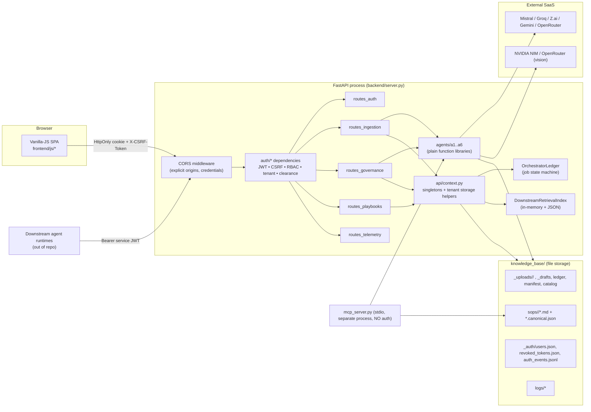

# 03 — System Architecture

## 1. Big picture

A **single-process modular monolith**: one FastAPI app serves both the REST API and the static dashboard. State lives in module-level singletons backed by JSON files. LLM calls go to external SaaS providers.

## 2. The six "agents" are libraries, not services

`backend/agents/a1_… a6_…` are Python packages of functions. In the live API path (`routes_ingestion.api_ingest_single`) the route handler **directly calls them in sequence**; there is no message passing. A second, *protocol-driven* implementation exists (`orchestrator/bus.py` + `agent_runners.py` + `schemas/protocol_msg.py`, "msg/1.0") but is used **only by the CLI tracer `trace_pipeline.py` and tests**. `api/context.py` instantiates `agent_bus = AgentMessageBus()` but no route uses it.

| Agent | Package | Real responsibility |
|---|---|---|
| A1 Ingestion | `a1_ingestion` | intake validation (extension, size, magic bytes, zip-bomb, page/word caps), ordered extraction, VLM screenshot analysis, link scraper (unused in live flow) |
| A2 Structuring | `a2_structuring` | triage router (optional), JIT execution planner (LLM + retries), canonical JSON builder, OKF playbook writer/HMAC signer, text cleaner |
| A3 Security | `a3_security` | secret scanner (wraps DLP), regex "AST" sandbox, deterministic confidentiality scorer |
| A4 Verification | `a4_verification` | plan validator (Layer 1 deterministic + Layer 2 LLM), quote tracer, quality score |
| A5 Review | `a5_review` | `sod_policy.py` (SoD + the 6 gates — the real core), draft store, task manager (used by msg/1.0 runners) |
| A6 Hub | `a6_hub` | retrieval catalog (index/search/purge), `publisher.py` (re-exports), rulebook manager stub |

## 3. Request lifecycle through the stack

1. Browser → `/api/...` with cookie `elone_session` (path `/api`) and header `X-CSRF-Token` (value of cookie `elone_csrf`).
2. `CORSMiddleware` (origins from `ELONE_ALLOWED_ORIGINS`; `*` rejected at startup).
3. Route handler calls `authenticate_request(request, allowed_roles, human_only, check_csrf)` — **manually in each handler** (not a global dependency). Missing call = unauthenticated route.
4. Handler does tenant (`enforce_tenant_access`) and clearance (`enforce_clearance_access`) checks against server-derived resource metadata.
5. Business logic → ledger / files → `JSONResponse`.
6. `AuthAccessError` is mapped by an app-level exception handler to `{"error","error_code"}`.

## 4. Storage & consistency model
- Ledger (`_governance_ledger.json`) and catalog (`_retrieval_catalog.json`) are loaded once at import, mutated in memory, re-saved atomically on every mutation. Some GET handlers call `governance_ledger.load()` which **replaces the in-memory dict from disk**.
- Consequence: correct for **one worker process only**. Two uvicorn workers would diverge silently.

## 5. Deployment topology implied by code
Dev-only: `python backend/server.py` → `uvicorn.run("server:app", host="127.0.0.1", port=8000, reload=True)`. No production server config exists in the repo (see [12](12-deployment-guide.md)).

## 6. Trust boundaries
| Boundary | Control |
|---|---|
| Internet/browser → API | CORS allow-list, JWT, CSRF (cookie mode), RBAC |
| Uploaded document → LLM | DLP/quarantine (text only), regex threat scan, delimiter escaping `<untrusted_document_payload>`, validator LLM |
| LLM output → disk | Pydantic schema, deterministic Layer-1 checks, quote tracing, human review, HMAC |
| Tenant A ↔ B | app-layer `tenant_id` filters on every handler (no physical isolation) |
| Agents → catalog | token-derived tenant/clearance/persona; body values ignored |
| MCP client → server | **none** (local stdio trust) |
