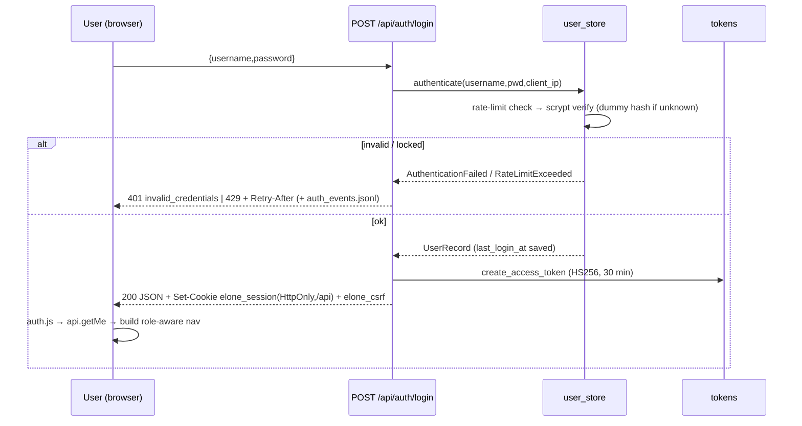
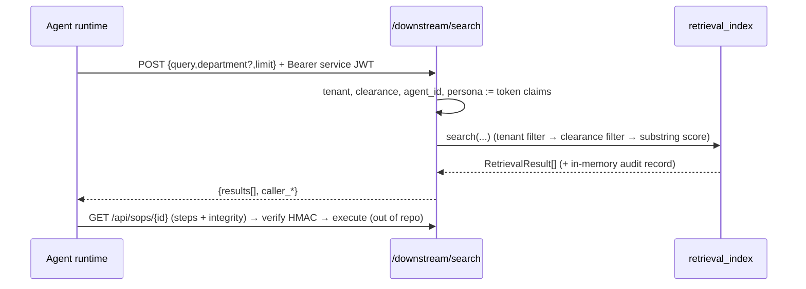

# 09 — End-to-End Business Workflows

## W1. Sign-in

Next screen: dashboard filtered by `canAccessView()`. Agent accounts are logged out immediately by the SPA (`initAuth`).

## W2. Ingest an SOP (the core pipeline)

```mermaid
sequenceDiagram
  autonumber
  participant PO as Process Owner (UI ingestion.js)
  participant R as routes_ingestion
  participant A1 as A1 extractor/validator
  participant A3 as A3 DLP + regex scan
  participant L as OrchestratorLedger
  participant A2 as A2 planner (LLM)
  participant A4 as A4 validator (LLM) + quote tracer
  participant FS as _drafts / manifest
  PO->>R: POST /uploads/upload (multipart)
  R-->>PO: gate1_passed + metadata
  PO->>R: POST /uploads/ingest {filename,[sop_id],[reingest]}
  R->>A1: validate_sop_file (Gate 1)
  R->>R: _begin_ingest (409 if already running); allocate job/sop ids
  R->>A1: extract_ordered_sop_content (text+images, DLP pre-redaction for pdf/docx)
  R->>A3: redact_sensitive_dlp → secrets_count
  R->>L: start_job (duplicate? → 409)
  R->>L: received→extracting→scanning
  alt secrets_count > 0
    R->>L: trigger_quarantine (INC-xxxxxx), delete upload + parser logs
    R-->>PO: 403 quarantined (0 LLM calls)
  else clean
    R->>A3: scan_raw_sop_for_ast_threats
    alt threats
      R->>L: →blocked ; R-->>PO: 403 ast_threat_detected
    else clean
      R->>L: →structuring
      R->>A2: plan_okf_from_raw (VLM per image, planner ≤3 attempts)
      A2->>A4: validate_plan_faithfulness_and_linkage (L1 + L2 LLM)
      A2-->>R: draft (frontmatter, steps, vlm_reports, raw_text)
      alt not executable
        R->>L: →rejected ; R-->>PO: 200 unactionable
      else executable
        R->>L: →assessing
        R->>A4: build_canonical_sop_from_draft (quotes, coverage, quality Q, confidentiality)
        R->>L: create_review_task (→awaiting_review, SLA 24/48 h)
        R->>FS: write _drafts/<SOP>.draft.json, manifest, debug log
        R-->>PO: 200 awaiting_review + draft + canonical_draft
      end
    end
  end
```
Error handling: `IngestionCancelled` → job `failed` ("Cancelled by …") and 200 `cancelled`; any other exception → job `failed` (if still in a working state), manifest `failed`, HTTP 500 `INGESTION_ERROR` with `str(e)`. `_end_ingest` always releases the in-flight lock. Quota exhaustion raises `DailyQuotaExceededError` → falls into the generic 500 path.

Rules: per-job LLM call budget (`max_calls_per_job`, default 25); Layer-1 failures stop before the validator LLM; if Layer-1/2 still fail after 3 attempts → `ValueError("Ingestion blocked …")`.

## W3. Review decision (dual custody)
```mermaid
sequenceDiagram
  participant SR as Security Reviewer (review-task.js)
  participant R as routes_governance
  participant P as sod_policy
  participant L as Ledger
  SR->>R: POST /review-tasks/{id}/decision {decision, notes, confirmed_classification}
  R->>R: auth(role=SR) → find job by task → tenant check
  R->>R: read draft → tier → clearance ≥ tier
  R->>R: derive last_editor from draft/job history (server-side)
  opt decision == approve
    R->>P: evaluate_draft_publication_gates(job, draft, body_confirmed_classification)
    P-->>R: 6 gates (secrets, schema+binding, traceability≥90, completeness≥80, issues=0 + AST, tier confirmed)
    R->>R: stamp draft: approvals[], classification.confirmed, sha256 binding
    R->>R: canonical_sha256 & draft_sha256 of stamped draft
  end
  R->>L: record_review_decision (state must be awaiting_review; SoD uploader≠reviewer≠last_editor; gates passed)
  L-->>R: →approved | changes_requested | rejected
  R->>R: atomically rewrite draft file (rollback ledger on failure); update manifest
  R-->>SR: {status, decision, job_state, canonical_sha256, gate_check}
```
Errors: 403 SoD / not-human / clearance / role; 400 `gates_failed` with per-gate reasons; 400 `invalid_state` for non-awaiting jobs.
Next screen: queue refresh; `approved` jobs surface a **Publish** action for the Process Owner.

## W4. Changes requested loop
`changes_requested` → Process Owner edits (steps / canonical JSON; any edit resets `classification.confirmed` and sets `last_editor`) → `POST /drafts/{id}/resubmit` → `awaiting_review` + new `RT-…` → a reviewer who is neither uploader nor last editor decides again. Note: if the *only* eligible reviewer previously edited, SoD blocks them (UI shows blockers list).

## W5. Publish
`POST /governance/sops/{id}/publish` (PO) → locate `approved` job (tenant-scoped) → reload stored draft → verify sop_id/tenant/file-hash binding → recompute canonical & draft hashes and **re-run all gates (Gate 6 requires `classification.confirmed` from the stamp)** → `ledger.publish_approved_sop` (version, content hash, canonical hash, draft hash) → `write_okf_playbook` (HMAC) → `index_published_sop` → delete draft → manifest `success`. Any exception after the ledger transition rolls the job back to `approved`. Response includes `citation` (`<sop>@v<ver>#<sha10>`).

## W6. Downstream agent lookup


## W7. Delete a playbook (admin)
`DELETE /api/sops/{id}` → tenant & clearance checks → collect `.md`, `.canonical.json`, rulebook, drafts → move to `_trash/<stamp>_<id>/` + `_manifest.json` → purge from catalog → ledger jobs `soft_deleted` → refresh index pages → clean manifest. The source upload remains, enabling re-ingest.

## W8. Admin: user & service token
Settings → create user (human or `agent` with persona/clearance ≤ persona cap) → "Issue token" → copy bearer JWT (shown once; not stored). Disable/enable via PATCH.

## W9. Config change
Settings → `POST /api/config` → `validate_config_updates` (422 on any bad field, nothing saved) → write both JSON files → reload → audit lines. Effect is immediate for newly-built validators; note some constants (e.g. `intake_validator.MAX_*`) are captured at import but the check functions re-read settings dynamically.

## Failure behaviours users see
| Situation | Response / UI |
|---|---|
| expired/revoked token | 401 → login screen |
| wrong role | 403 `insufficient_role` toast |
| quarantine | 403 + incident id, file removed |
| LLM provider down | after retries → 500 `INGESTION_ERROR`, job `failed`, can retry (`reingest`) |
| process crash mid-ingest | job stuck in a working state; `/uploads` shows `failed: Interrupted in '<state>' state` |
