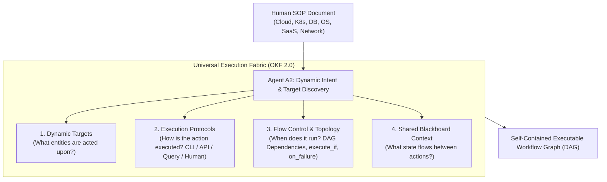
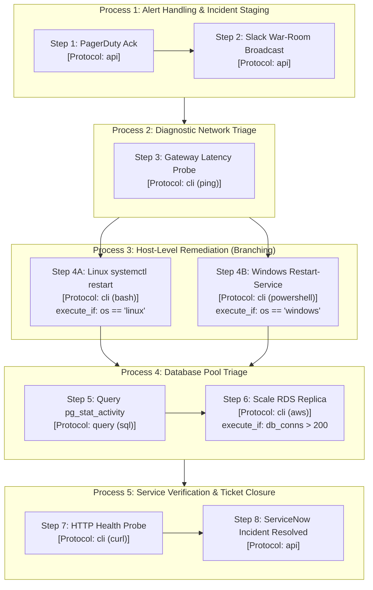

# Dynamic Multi-Platform & Hybrid Workflow Architecture (OKF 2.0)

> **Document Status**: Approved Architecture Specification (Future Implementation Roadmap)  
> **Target Version**: Elone Agent Core / OKF Schema v2.0  
> **Author**: Google DeepMind / Antigravity Engineering  
> **Date**: November 2026  
> **Section**: 15 - Future Architecture & Dynamic Workflows  
> **Related Documents**:  
> - `project-documentation/03-system-architecture.md`  
> - `project-documentation/09-business-workflows.md`  
> - `project-documentation/13-gaps-and-recommendations.md`  

---

## 1. Executive Summary & Problem Statement

### 1.1 The Legacy Limitation (Single-OS "Flat Script" Paradigm)
In early iterations of the Elone Agent ingestion pipeline, command synthesis defaulted to a single execution environment: **Dedicated Windows PowerShell** (`target_os: windows`, `shell: powershell`). 

When an SOP document contained instructions spanning multiple environments—such as initial Network checks, Windows server steps, Linux daemon management, cloud infrastructure provisioning, and SaaS API calls—the converter faced a dilemma:
1. **Command Syntax Clashing**: It could not inject Linux Bash or cloud API calls into a PowerShell script without syntax corruption or execution failures.
2. **Lost Automation**: To maintain schema validity, non-Windows actions were relegated to `source_action_coverage` as `manual_ui_omitted`, demoting the playbook to `partially_automated` and forcing human operators to perform automated steps manually.
3. **Flat-List Fragility**: Modeling procedures as a 1-dimensional array (`steps: [1, 2, 3... N]`) failed to capture real-world operational phases, parallel branches, and conditional dependencies.

### 1.2 The Real-World Reality
Enterprise standard operating procedures are **heterogeneous, multi-process, and hybrid**:
* **Multi-Domain**: A single incident frequently touches Network gateways, Windows application hosts, Linux database clusters, Kubernetes pods, and SaaS portals.
* **Hybrid Execution (`CLI + Tool`)**: Procedures blend command-line scripts (`Test-Connection`, `systemctl`, `kubectl`) with API tools (ServiceNow incident tickets, PagerDuty alert acks, Okta MFA factor resets, AWS CloudWatch metrics) and Human Approval gates.
* **Non-Linear Topologies**: Procedures have distinct phases (Triage $\rightarrow$ Remediation $\rightarrow$ Verification $\rightarrow$ Escalation/Closure) that branch conditionally based on dynamic runtime variables.

### 1.3 The Core Solution
Elone Agent evolves from a **flat command generator** into a **Universal Declarative Policy Graph (Workflow DAG)**. Operating systems, cloud providers, and SaaS tools are not hardcoded enums; instead, they are treated as **abstract execution targets** orchestrated across **universal execution protocols**.

---

## 2. The 4 Universal Primitives

The architecture models any human or automated procedure through 4 foundational primitives:



### Primitive 1: Dynamic Target Discovery
Targets are dynamically extracted entities representing where an action occurs. Zero hardcoded OS or platform constraints exist in the core engine.
```json
"targets": [
  { "id": "t_gw", "name": "Corporate Edge Gateway", "domain": "network", "type": "gateway" },
  { "id": "t_db", "name": "Payment Database Primary", "domain": "database", "type": "postgresql" },
  { "id": "t_k8s", "name": "Production EKS Cluster", "domain": "cloud_containers", "type": "kubernetes" },
  { "id": "t_snow", "name": "Enterprise ITSM", "domain": "saas", "type": "servicenow" }
]
```

### Primitive 2: Universal Execution Protocols
Every discrete operational action is categorized into one of 4 execution protocols:

| Protocol | Description | Payload Schema | Real-World Examples |
| :--- | :--- | :--- | :--- |
| **`cli`** | Executes a command string via an engine/shell on a target. | `{ "command": "...", "shell": "powershell \| bash \| sh \| zsh \| cmd", "target": "t_id" }` | `kubectl rollout restart`, `systemctl restart nginx`, `Test-Connection`, `terraform apply`. |
| **`api`** | Dispatches a structured HTTP / REST / GraphQL / gRPC call. | `{ "platform": "...", "function_name": "...", "comm_inputs": {...} }` | ServiceNow incident status patch, Okta MFA factor reset, PagerDuty ack, Slack webhook. |
| **`query`** | Queries telemetry, databases, or metric systems to fetch state. | `{ "query_type": "sql \| promql \| logql \| jmespath", "query_str": "...", "target": "t_id" }` | `SELECT count(*) FROM locks`, PromQL CPU threshold query, Datadog metric fetch. |
| **`human_gate`** | Suspends execution for human authorization or physical input. | `{ "role": "L2_Lead \| SecOps", "timeout_min": 30, "action_prompt": "..." }` | High-risk production failover confirmation, 2FA hardware key tap, manual invoice review. |

### Primitive 3: Dynamic Context Blackboard (Shared State)
A central, strongly-typed state blackboard maintains variables across disparate tools and shells during workflow execution:
* **Output Bindings**: Any step can capture its execution output (`stdout`, `exit_code`, or `response_json`) into the blackboard via regex or JSONPath.
* **Input Resolution**: Downstream steps interpolate blackboard variables using `{{variables.entity_name}}` or `{{context.field}}`.

```
[Step 1: API Protocol (Datadog)]
   └─► Captures: context.failed_pod = "billing-svc-9f82d-1x0pq"
         │
         ▼
[Step 2: CLI Protocol (Kubernetes)]
   └─► Command: kubectl logs {{context.failed_pod}} -n prod --tail=50
   └─► Output Binding: regex "Out of Memory" ──► context.is_oom = true
         │
         ▼
[Step 3: CLI Protocol (Terraform) — execute_if: "context.is_oom == true"]
   └─► Command: terraform apply -var="pod_mem=4Gi" -auto-approve
         │
         ▼
[Step 4: API Protocol (ServiceNow)]
   └─► Comm Inputs: { "ticket_id": "{{entities.ticket_id}}", "work_notes": "Remediated OOM on {{context.failed_pod}}" }
```

### Primitive 4: Flow Control & Graph Topology
Rather than linear execution, actions form a Directed Acyclic Graph (DAG):
* **`depends_on`**: Upstream prerequisite steps that must complete before execution begins.
* **`execute_if`**: Dynamic boolean expressions evaluated against the blackboard state (e.g. `context.target_os == 'linux'`, `context.ping_failed == true`).
* **`on_failure`**: Granular exception routing (e.g. `retry(max=3)`, `fallback_step_id`, `escalate_to(role="Tier2")`).

---

## 3. OKF 2.0 Schema Contract

The following schema extends `OKFPlaybookModel` to support multi-process, cross-platform, and hybrid workflows while guaranteeing backwards compatibility.

```json
{
  "$schema": "https://json-schema.org/draft/2020-12/schema",
  "title": "OKFPlaybook_v2",
  "type": "object",
  "properties": {
    "sop_id": { "type": "string", "example": "SOP-INC-042" },
    "title": { "type": "string" },
    "workflow_topology": { 
      "type": "string", 
      "enum": ["linear_single_target", "branched_multi_target", "multi_process_dag"] 
    },
    "targets": {
      "type": "array",
      "items": {
        "type": "object",
        "properties": {
          "id": { "type": "string" },
          "name": { "type": "string" },
          "domain": { "type": "string" },
          "type": { "type": "string" }
        },
        "required": ["id", "name", "type"]
      }
    },
    "processes": {
      "type": "array",
      "description": "Ordered operational phases / sub-processes",
      "items": {
        "type": "object",
        "properties": {
          "process_id": { "type": "string" },
          "name": { "type": "string" },
          "description": { "type": "string" },
          "target_id": { "type": "string" },
          "execute_if": { "type": ["string", "null"] },
          "depends_on_processes": { "type": "array", "items": { "type": "string" } },
          "steps": {
            "type": "array",
            "items": {
              "type": "object",
              "properties": {
                "step_id": { "type": "string" },
                "step_number": { "type": "integer" },
                "action": { "type": "string" },
                "source_quote": { "type": "string" },
                "protocol": { 
                  "type": "string", 
                  "enum": ["cli", "api", "query", "human_gate"] 
                },
                "protocol_payload": {
                  "type": "object",
                  "description": "Specific to protocol type (command/shell, or platform/function/inputs)"
                },
                "parse_instruction": { "type": ["string", "null"] },
                "output_bindings": { "type": "object" },
                "execute_if": { "type": ["string", "null"] },
                "on_failure": {
                  "type": "object",
                  "properties": {
                    "action": { "type": "string", "enum": ["fail", "skip", "retry", "fallback"] },
                    "fallback_command": { "type": ["string", "null"] },
                    "escalate_to": { "type": ["string", "null"] }
                  }
                },
                "timeout_seconds": { "type": "integer", "default": 60 }
              },
              "required": ["step_id", "step_number", "action", "source_quote", "protocol", "protocol_payload"]
            }
          }
        },
        "required": ["process_id", "name", "steps"]
      }
    },
    "source_action_coverage": {
      "type": "array",
      "description": "Exhaustive accounting of all human document actions"
    }
  },
  "required": ["sop_id", "title", "workflow_topology", "processes"]
}
```

> [!NOTE]
> **Zero Breaking Changes (Backward Compatibility)**:  
> When loading a legacy OKF 1.0 playbook with a flat `steps: [...]` list, a Pydantic model validator automatically wraps it into:
> `processes = [ProcessModel(process_id="proc_default", name="Primary Procedure", steps=legacy_steps)]`.

---

## 4. Agent Pipeline Integration Blueprint

Implementing this dynamic model enhances each agent without disrupting existing security gates or quality scoring:

```
[A1: Ingestion]  ──► Preserves layout order, text blocks, and embedded diagrams.
                            │
[A3: Threat Gate] ──► Checks DLP secrets & AST threat patterns across ALL protocols.
                            │
[A2: Structuring] ──► Stage 1: Topology & Target Discovery
                  ──► Stage 2: Two-Pass Graph Synthesis (Process Map -> Step Binding)
                            │
[A4: Quality]     ──► Quote Traceability (100% across all protocols)
                  ──► Line Coverage Accounting (Calculates C over all processes)
                  ──► Graph Cycle Detection (Ensures DAG has no circular dependencies)
                            │
[A5/A6: Review]   ──► Dual-custody staging, HMAC-SHA256 signature, Catalog indexing.
```

### 4.1 Agent A2: Two-Pass Hierarchical Synthesis
1. **Pass 1 (Macro: Topology & Target Discovery)**:
   The LLM inspects the raw text and identifies:
   * What target systems/services exist?
   * What distinct operational phases exist (e.g. Network Triage, Host Remediation, Verification)?
   * Are branches mutually exclusive (e.g. OS branches) or sequential?
2. **Pass 2 (Micro: Protocol Binding & State Linking)**:
   * Emits steps mapped to their native protocols (`cli`, `api`, `human_gate`).
   * Binds output captures into `context.*` variables for downstream consumption.
   * Eliminates false `manual_ui_omitted` classifications.

### 4.2 Agent A4: Universal Quality & Verification
* **Quote Traceability ($T$)**: Verifies every step's `source_quote` against document lines. Because CLI commands, API calls, and manual checkpoints all cite the text directly, $T$ remains $100\%$.
* **Line Coverage ($C$)**: Commands from alternative branches are counted under their respective process blocks instead of being discarded, raising Completeness ($C$) to $100\%$.
* **DAG Integrity Validation**: Verifies that `depends_on` and `execute_if` variable references do not contain cycles, deadlocks, or undefined variables.

---

## 5. End-to-End Dynamic Workflow Exemplar

### 5.1 Raw Human SOP Scenario: Multi-Tier Service Outage
A single company document describes recovering a degraded payment service:
1. "Ack incident in PagerDuty and post in #war-room Slack channel."
2. "Check network gateway latency via ping."
3. "If target host is Linux, inspect `systemctl status payment-api` and restart if failed."
4. "If target host is Windows, query `Get-Service PaymentSvc` and restart via PowerShell."
5. "If database connection pool is exhausted, run SQL `SELECT count(*) FROM pg_stat_activity` on PostgreSQL."
6. "If DB active connections exceed 200, scale AWS RDS read-replica via AWS CLI."
7. "Confirm HTTP health check responds 200 OK."
8. "Update ticket in ServiceNow and resolve incident."

### 5.2 Synthesized Dynamic OKF 2.0 Playbook Graph



---

## 6. Phased Implementation Roadmap

When engineering is authorized to implement this specification, work should proceed in 3 distinct, test-verified phases:

### Phase 1: Protocol & Shell Decoupling (Foundation)
* **Goal**: Stop hardcoding `target_os: windows` and `shell: powershell`.
* **Changes**:
  - Update `jit_converter_prompts.py` to allow `target_os: cross-platform` and multi-shell emission (`bash`, `powershell`, `cmd`, `sh`).
  - Allow `step_type: command` and `step_type: tool_call` to sit side-by-side without mutual exclusion.
* **Verification**: Run `test_agents_modular.py` to ensure existing golden tests pass.

### Phase 2: Process Blocks & Workflow DAG (Schema & Structuring)
* **Goal**: Support hierarchical `processes` and DAG dependencies.
* **Changes**:
  - Extend `okf_schema.py` and `canonical_sop_schema.py` with `processes: List[ProcessModel]`.
  - Add backward-compatibility validator for legacy flat `steps`.
  - Update `triage_router.py` to output `workflow_topology: "multi_process_dag"`.
* **Verification**: Ingest `SOP_Server_Down_Multi_Platform_Recovery.txt` and confirm Linux steps are actively executed in their own process block ($100\%$ automation).

### Phase 3: Runtime Dispatcher & Blackboard Context (Execution)
* **Goal**: Provide stateful variable interpolation across different protocol runners.
* **Changes**:
  - Implement the in-memory execution blackboard (`WorkflowContext`).
  - Build universal protocol driver interfaces (`CLIAdapter`, `APIAdapter`, `HumanGateAdapter`).
* **Verification**: Execute a simulated multi-process workflow in `ast_sandbox.py` with cross-adapter variable passing.

---

## 7. Architectural Guarantees & Constraints

1. **Zero Domain Lock-In**: No code in the parsing, structuring, or verification layers shall assume an action is restricted to a specific operating system, vendor, or cloud provider.
2. **Determinism over Guesswork**: The structuring agent must ground all dynamic targets, commands, endpoints, and conditions in verbatim source text ($T \ge 90\%$). Hallucinated tools or parameters are blocked by Agent A4.
3. **Least Privilege Sandboxing**: Agent A3 AST and DLP sandboxes inspect commands across all protocols prior to execution (blocking unconstrained delete, dropped tables, or leaked bearer tokens).
4. **Resilience**: A failure in a conditional sub-branch must execute its declared `on_failure` recovery path without crashing the broader workflow state machine.

